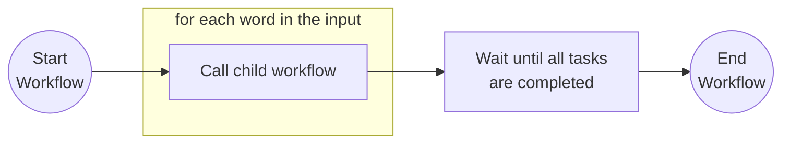
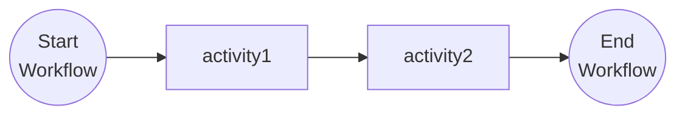

# Child Workflows

This tutorial demonstrates how a workflow can call child workflows that are part of the same application. Child workflows can be used to break up large workflows into smaller, reusable parts. For more information about child workflows see the [Dapr docs](https://docs.dapr.io/developing-applications/building-blocks/workflow/workflow-features-concepts/#child-workflows).

## Inspect the code

Open the `workflow.go` file in the `tutorials/workflow/go/child-workflows/childworkflows` folder. This file contains the definition for the workflows and activities.

The `main.go` file in the same folder registers the workflows and the activities, starts the workflow worker, and exposes the `POST /start` endpoint that schedules a workflow instance.

The parent workflow iterates over the input array and schedules an instance of the `ChildWorkflow` for each of the input elements. The `ChildWorkflow` is a basic task-chaining workflow that contains a sequence of two activities. When all of the instances of the `ChildWorkflow` complete, then the `ParentWorkflow` finishes.

### Parent workflow



### Child workflow



## Run the tutorial

1. Use a terminal to navigate to the `tutorials/workflow/go/child-workflows` folder.
2. Use the Dapr CLI to run the Dapr Multi-App run file. The first run downloads the Go dependencies, which can take a minute.

    <!-- STEP
    name: Run multi app run template
    expected_stdout_lines:
    - 'Started Dapr with app id "childworkflows"'
    expected_stderr_lines:
    working_dir: .
    output_match_mode: substring
    background: true
    sleep: 60
    timeout_seconds: 120
    -->
    ```bash
    dapr run -f .
    ```
    <!-- END_STEP -->

3. Use the POST request in the [`childworkflows.http`](./childworkflows.http) file to start the workflow, or use this cURL command:

    ```bash
    curl -i --request POST \
    --url http://localhost:5259/start \
    --header 'content-type: application/json' \
    --data '["Item 1","Item 2"]'
    ```

    Note the `instance_id` property in the response. This property contains the workflow instance ID. You can use this ID to get the status of the workflow instance you just started.

    The input of the workflow is an array with two strings:

    ```json
    [
        "Item 1",
        "Item 2"
    ]
    ```

    The app logs show that each activity of the child workflow receives both items of the input array. The child workflows run at the same time, so the order of the lines can differ between runs. The lines for one item stay in order:

    ```text
    activity1: Received input: Item 1.
    activity1: Received input: Item 2.
    activity2: Received input: Item 1 is processed.
    activity2: Received input: Item 2 is processed.
    ```

4. Use the GET request in the [`childworkflows.http`](./childworkflows.http) file to get the status of the workflow, or use this cURL command:

    ```bash
    curl --request GET --url http://localhost:3559/v1.0/workflows/dapr/<INSTANCEID>
    ```

    Where `<INSTANCEID>` is the workflow instance ID you received in the `instance_id` property in the previous step.

    The expected serialized output of the workflow is an array with two strings:

    ```txt
    "[\"Item 1 is processed as a child workflow.\",\"Item 2 is processed as a child workflow.\"]"
    ```

5. Stop the Dapr Multi-App run process by pressing `Ctrl+C`.

## Run without Docker

By default, the tutorial uses Redis in Docker as the workflow state store, and the Dapr Placement and Scheduler services in Docker. You can run the tutorial without Docker and Redis and instead run the Dapr binaries as processes, and use an SQLite file to keep the workflow state.

Use this option when Docker is not available or not allowed, for example on a locked-down laptop, in a CI job, or in a dev container without Docker. It also starts faster, because it has fewer moving parts.

The commands are for Linux and macOS, and for Windows (PowerShell).

### Prerequisites without Docker and Redis

- [Dapr CLI](https://docs.dapr.io/getting-started/install-dapr-cli/). You do not need `dapr init` with Docker. Step 1 installs the binaries.
- [Go](https://go.dev/doc/install)
- SQLite needs no install. `daprd` includes the SQLite state store.

1. Install the Dapr binaries with `dapr init --slim`. This command installs `daprd`, `placement`, and `scheduler` in `$HOME/.dapr/bin` (`$env:USERPROFILE\.dapr\bin` on Windows, with the `.exe` extension). It does not start them.
2. Open a terminal in this folder and start the Scheduler service.

    Linux and macOS:

    ```bash
    $HOME/.dapr/bin/scheduler --etcd-data-dir ./scheduler-data
    ```

    Windows (PowerShell):

    ```powershell
    & "$env:USERPROFILE\.dapr\bin\scheduler.exe" --etcd-data-dir .\scheduler-data --port 6060
    ```

    On Windows, `dapr run` connects to the Scheduler service on port 6060 and to the Placement service on port 6050. On Linux and macOS, it uses ports 50006 and 50005. For this reason, the Windows commands set `--port`.

3. Open a second terminal in this folder and start the Placement service. It uses other ports than the Scheduler service, which uses ports 8080 and 9090 by default.

    Linux and macOS:

    ```bash
    $HOME/.dapr/bin/placement --healthz-port 8081 --metrics-port 9091
    ```

    Windows (PowerShell):

    ```powershell
    & "$env:USERPROFILE\.dapr\bin\placement.exe" --healthz-port 8081 --metrics-port 9091 --port 6050
    ```

    On Dapr 1.19 and later, you can skip this step. Then add `--placement-enabled=true` to the Scheduler command in step 2.

4. Open a third terminal in this folder and run the tutorial with the run file `dapr-sqlite.yaml`:

    ```bash
    dapr run -f dapr-sqlite.yaml
    ```

    Then follow steps 3 to 5 of the section "Run the tutorial".

`dapr-sqlite.yaml` is the same as `dapr.yaml`, but its `resourcesPath` points to the [`resources-sqlite`](../../resources-sqlite/) folder. That folder has a SQLite state store with `actorStateStore` set to `"true"`.

## Files

```
child-workflows/
├── README.md             # this file
├── dapr.yaml             # `dapr run -f .` config (appID, resources, command)
├── dapr-sqlite.yaml      # same, with the SQLite state store
├── childworkflows.http   # the requests of this tutorial
├── makefile              # wires the tutorial into `make validate`
├── go.mod                # module and dependencies
├── go.sum
└── childworkflows/
    ├── main.go           # registry, worker, and the HTTP endpoint
    └── workflow.go       # the parent and child workflows and the two activities
```
