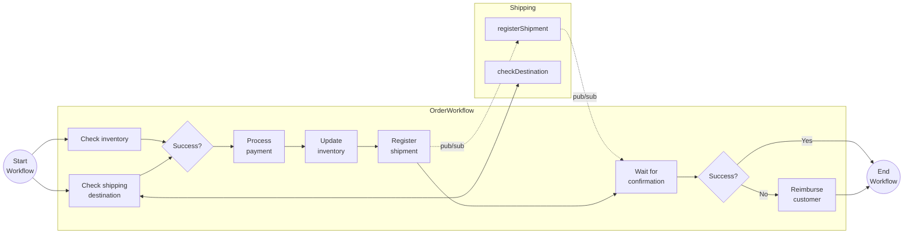

# Combined Workflow Patterns

This tutorial demonstrates how several workflow patterns can be combined in a single, more realistic, workflow. Some of the workflow activities are using other Dapr APIs, such as state management, service invocation, and Pub/Sub.

## Inspect the code

The demo consists of two applications:

- `workflowapp` is the main application that orchestrates an order process in the `OrderWorkflow`.
- `shippingapp` is a supporting service that the `OrderWorkflow` calls.

The `OrderWorkflow` combines task chaining, fan-out/fan-in, and waiting for external event patterns. The workflow contains several activities for order processing: checking the inventory, registering the shipment, processing the payment and more. The workflow returns a final order status with the results of the order. It uses compensating logic when the shipment fails to register and the customer needs a reimbursement for the payment.

Open the `workflow.go` file in the `tutorials/workflow/go/combined-patterns/workflowapp` folder. This file contains the definition for the workflow and the activities. The `inventory.go` file in the same folder keeps the inventory in a Dapr state store. The `main.go` file registers the workflow and the activities, starts the workflow worker, and exposes the `POST /start` endpoint that schedules a workflow instance. It also exposes the `POST /shipmentRegistered` endpoint, which receives the Pub/Sub message of the shipping app and raises an event on the workflow instance.

The `main.go` file in the `shippingapp` folder exposes two endpoints. The `POST /checkDestination` endpoint answers the service invocation of the workflow. The `POST /registerShipment` endpoint receives the Pub/Sub message of the workflow app.



## Run the tutorial

1. Use a terminal to navigate to the `tutorials/workflow/go/combined-patterns` folder.
2. Use the Dapr CLI to run the Dapr Multi-App run file. This starts both applications `order-workflow` and `shipping` with the Dapr components in the [resources](./resources) folder. The first run downloads the Go dependencies, which can take a minute.

    <!-- STEP
    name: Run multi app run template
    expected_stdout_lines:
    - 'Started Dapr with app id "order-workflow"'
    - 'Started Dapr with app id "shipping"'
    expected_stderr_lines:
    working_dir: .
    output_match_mode: substring
    background: true
    sleep: 60
    timeout_seconds: 120
    -->
    ```bash
    dapr run -f .
    ```
    <!-- END_STEP -->

3. Use the POST request in the [`order-workflow.http`](./order-workflow.http) file to start the workflow, or use this cURL command:

    ```bash
    curl -i --request POST \
    --url http://localhost:5260/start \
    --header 'content-type: application/json' \
    --data '{"id": "b0d38481-5547-411e-ae7b-255761cce17a","order_item" : {"product_id": "RBD001","product_name": "Rubber Duck","quantity": 10,"total_price": 15.00},"customer_info" : {"id" : "Customer1","country" : "The Netherlands"}}'
    ```

    The input for the workflow is an `Order` object:

    ```json
    {
        "id": "b0d38481-5547-411e-ae7b-255761cce17a",
        "order_item" : {
            "product_id": "RBD001",
            "product_name": "Rubber Duck",
            "quantity": 10,
            "total_price": 15.00
        },
        "customer_info" : {
            "id" : "Customer1",
            "country" : "The Netherlands"
        }
    }
    ```

    The app logs should come from both services executing all activities as follows:

    ```text
    2026/10/24 02:20:08 start: Received input: {ID:b0d38481-5547-411e-ae7b-255761cce17a OrderItem:{ProductID:RBD001 ProductName:Rubber Duck Quantity:10 TotalPrice:15} CustomerInfo:{ID:Customer1 Country:The Netherlands}}
    order_workflow: Received order id: b0d38481-5547-411e-ae7b-255761cce17a.
    check_shipping_destination: Received input: {ID:Customer1 Country:The Netherlands}.
    check_inventory: Received input: {ProductID:RBD001 ProductName:Rubber Duck Quantity:10 TotalPrice:15}.
    get_inventory_item: {ProductID:RBD001 ProductName:Rubber Duck Quantity:50}
    2026/10/24 02:20:08 checkDestination: Received input: {ID:Customer1 Country:The Netherlands}.
    process_payment: Received input: {ID:b0d38481-5547-411e-ae7b-255761cce17a OrderItem:{ProductID:RBD001 ProductName:Rubber Duck Quantity:10 TotalPrice:15} CustomerInfo:{ID:Customer1 Country:The Netherlands}}.
    order_workflow: Payment result: {IsSuccess:true Message:}.
    update_inventory: Received input: {ProductID:RBD001 ProductName:Rubber Duck Quantity:10 TotalPrice:15}.
    get_inventory_item: {ProductID:RBD001 ProductName:Rubber Duck Quantity:50}
    register_shipment: Received input: {ID:b0d38481-5547-411e-ae7b-255761cce17a OrderItem:{ProductID:RBD001 ProductName:Rubber Duck Quantity:10 TotalPrice:15} CustomerInfo:{ID:Customer1 Country:The Netherlands}}.
    2026/10/24 02:20:08 registerShipment: Received input: {ID:b0d38481-5547-411e-ae7b-255761cce17a CustomerInfo:{ID:Customer1 Country:The Netherlands}}.
    2026/10/24 02:20:08 shipmentRegistered: Received input: {OrderID:b0d38481-5547-411e-ae7b-255761cce17a IsSuccess:true Message:}
    ```

4. Use the GET request in the [`order-workflow.http`](./order-workflow.http) file to get the status of the workflow, or use this cURL command:

    ```bash
    curl --request GET --url http://localhost:3560/v1.0/workflows/dapr/b0d38481-5547-411e-ae7b-255761cce17a
    ```

    The expected serialized output of the workflow is the `dapr.workflow.output` property:

    ```txt
    "dapr.workflow.output":"{\"is_success\":true,\"message\":\"Order b0d38481-5547-411e-ae7b-255761cce17a processed successfully.\"}"
    ```

    *The `order-workflow.http` file generates a new order ID for each request.*

5. Stop the Dapr Multi-App run process by pressing `Ctrl+C`.

## Run without Docker

This tutorial has no SQLite variant. The workflow apps talk to each other with Pub/Sub, and the SQLite component of Dapr does not provide Pub/Sub. The tutorial needs Redis for the Pub/Sub messages and for the workflow state. Run `dapr init` to start Redis, the Placement service, and the Scheduler service in Docker.

## Files

```
combined-patterns/
├── README.md                # this file
├── dapr.yaml                # `dapr run -f .` config (app IDs, ports, resources, commands)
├── order-workflow.http      # the requests of this tutorial
├── makefile                 # wires the tutorial into `make validate`
├── go.mod                   # module and dependencies of both apps
├── go.sum
├── resources/               # Dapr components and subscriptions
│   ├── pubsub_redis.yaml
│   ├── state_redis.yaml
│   ├── state_memory.yaml
│   ├── subscription-shipping.yaml
│   └── subscription-workflow.yaml
├── workflowapp/
│   ├── main.go              # registry, worker, and the HTTP endpoints
│   ├── workflow.go          # the workflow and the activities
│   ├── inventory.go         # the inventory in the state store
│   └── models.go            # the data types
└── shippingapp/
    └── main.go              # the HTTP endpoints of the shipping service
```
