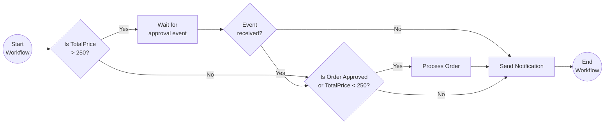

# External Events

This tutorial demonstrates how to author a workflow where the workflow will wait until it receives an external event. This pattern is often applied in workflows that require an approval step. For more information about the external system interaction pattern see the [Dapr docs](https://docs.dapr.io/developing-applications/building-blocks/workflow/workflow-patterns/#external-system-interaction).

## Inspect the code

Open the `workflow.go` file in the `tutorials/workflow/go/external-system-interaction/externalevents` folder. This file contains the definition for the workflow. It is an order workflow that requests an external approval if the order has a total price greater than 250 dollars. The workflow waits for the `approval-event` with `ctx.WaitForExternalEvent`. If the event does not arrive within 2 minutes, the wait ends with `workflow.ErrTaskCanceled` and the workflow sends a notification that the request timed out.

The `main.go` file in the same folder registers the workflow and the activities, starts the workflow worker, and exposes the `POST /start` endpoint that schedules a workflow instance.



## Run the tutorial

1. Use a terminal to navigate to the `tutorials/workflow/go/external-system-interaction` folder.
2. Use the Dapr CLI to run the Dapr Multi-App run file. The first run downloads the Go dependencies, which can take a minute.

    <!-- STEP
    name: Run multi app run template
    expected_stdout_lines:
    - 'Started Dapr with app id "externalevents"'
    expected_stderr_lines:
    working_dir: .
    output_match_mode: substring
    background: true
    sleep: 60
    timeout_seconds: 120
    -->
    ```bash
    dapr run -f .
    ```
    <!-- END_STEP -->

3. Use the POST request in the [`externalevents.http`](./externalevents.http) file to start the workflow, or use this cURL command:

    ```bash
    curl -i --request POST \
    --url http://localhost:5258/start \
    --header 'content-type: application/json' \
    --data '{"id": "b7dd836b-e913-4446-9912-d400befebec5","description": "Rubber ducks","quantity": 100,"total_price": 500}'
    ```

    The input for the workflow is an `Order` object:

    ```json
    {
        "id": "b7dd836b-e913-4446-9912-d400befebec5",
        "description": "Rubber ducks",
        "quantity": 100,
        "total_price": 500
    }
    ```

4. Use the GET request in the [`externalevents.http`](./externalevents.http) file to get the status of the workflow, or use this cURL command:

    ```bash
    curl --request GET --url http://localhost:3558/v1.0/workflows/dapr/b7dd836b-e913-4446-9912-d400befebec5
    ```

    The workflow should still be running since it is waiting for an external event.

    The app logs should look similar to the following:

    ```text
    2026/10/24 02:13:44 Received order: {ID:b7dd836b-e913-4446-9912-d400befebec5 Description:Rubber ducks Quantity:100 TotalPrice:500}
    request_approval: Request approval for order: b7dd836b-e913-4446-9912-d400befebec5.
    ```

5. Use the POST request in the [`externalevents.http`](./externalevents.http) file to send an `approval-event` to the workflow, or use this cURL command:

    ```bash
    curl -i --request POST \
    --url http://localhost:3558/v1.0/workflows/dapr/b7dd836b-e913-4446-9912-d400befebec5/raiseEvent/approval-event \
    --header 'content-type: application/json' \
    --data '{"order_id": "b7dd836b-e913-4446-9912-d400befebec5","is_approved": true}'
    ```

    The payload for the event is an `ApprovalStatus` object:

    ```json
    {
        "order_id": "b7dd836b-e913-4446-9912-d400befebec5",
        "is_approved": true
    }
    ```

    You can also raise the event with the Dapr CLI. The CLI sends the payload as a JSON string that holds the object. The workflow accepts both forms.

    ```bash
    dapr workflow raise-event --app-id externalevents b7dd836b-e913-4446-9912-d400befebec5/approval-event --input '{"order_id": "b7dd836b-e913-4446-9912-d400befebec5","is_approved": true}'
    ```

    *The workflow will only wait for the external approval event for 2 minutes before timing out. In this case you will need to start a new order workflow instance.*

6. Again use the GET request in the [`externalevents.http`](./externalevents.http) file to get the status of the workflow. The workflow should now be completed.

    The app logs should contain the following lines:

    ```text
    process_order: Processed order: b7dd836b-e913-4446-9912-d400befebec5.
    send_notification: Order b7dd836b-e913-4446-9912-d400befebec5 has been approved.
    ```

    The expected serialized output of the workflow is:

    ```txt
    "\"Order b7dd836b-e913-4446-9912-d400befebec5 has been approved.\""
    ```

7. Stop the Dapr Multi-App run process by pressing `Ctrl+C`.

## Run without Docker

By default, the tutorial uses Redis in Docker as the workflow state store, and the Dapr Placement and Scheduler services in Docker. You can run the tutorial without Docker and Redis and instead run the Dapr binaries as processes, and use an SQLite file to keep the workflow state.

Use this option when Docker is not available or not allowed, for example on a locked-down laptop, in a CI job, or in a dev container without Docker. It also starts faster, because it has fewer moving parts.

The commands are for Linux and macOS, and for Windows (PowerShell).

### Prerequisites without Docker and Redis

- [Dapr CLI](https://docs.dapr.io/getting-started/install-dapr-cli/). You do not need `dapr init` with Docker. Step 1 installs the binaries.
- [Go](https://go.dev/doc/install)
- SQLite needs no install. `daprd` includes the SQLite state store.

1. Install the Dapr binaries with `dapr init --slim`. This command installs `daprd`, `placement`, and `scheduler` in `$HOME/.dapr/bin` (`$env:USERPROFILE\.dapr\bin` on Windows, with the `.exe` extension). It does not start them.
2. Open a terminal in this folder and start the Scheduler service.

    Linux and macOS:

    ```bash
    $HOME/.dapr/bin/scheduler --etcd-data-dir ./scheduler-data
    ```

    Windows (PowerShell):

    ```powershell
    & "$env:USERPROFILE\.dapr\bin\scheduler.exe" --etcd-data-dir .\scheduler-data --port 6060
    ```

    On Windows, `dapr run` connects to the Scheduler service on port 6060 and to the Placement service on port 6050. On Linux and macOS, it uses ports 50006 and 50005. For this reason, the Windows commands set `--port`.

3. Open a second terminal in this folder and start the Placement service. It uses other ports than the Scheduler service, which uses ports 8080 and 9090 by default.

    Linux and macOS:

    ```bash
    $HOME/.dapr/bin/placement --healthz-port 8081 --metrics-port 9091
    ```

    Windows (PowerShell):

    ```powershell
    & "$env:USERPROFILE\.dapr\bin\placement.exe" --healthz-port 8081 --metrics-port 9091 --port 6050
    ```

    On Dapr 1.19 and later, you can skip this step. Then add `--placement-enabled=true` to the Scheduler command in step 2.

4. Open a third terminal in this folder and run the tutorial with the run file `dapr-sqlite.yaml`:

    ```bash
    dapr run -f dapr-sqlite.yaml
    ```

    Then follow steps 3 to 6 of the section "Run the tutorial".

`dapr-sqlite.yaml` is the same as `dapr.yaml`, but its `resourcesPath` points to the [`resources-sqlite`](../../resources-sqlite/) folder. That folder has a SQLite state store with `actorStateStore` set to `"true"`.

## Files

```
external-system-interaction/
├── README.md              # this file
├── dapr.yaml              # `dapr run -f .` config (appID, resources, command)
├── dapr-sqlite.yaml       # same, with the SQLite state store
├── externalevents.http    # the requests of this tutorial
├── makefile               # wires the tutorial into `make validate`
├── go.mod                 # module and dependencies
├── go.sum
└── externalevents/
    ├── main.go            # registry, worker, and the HTTP endpoint
    └── workflow.go        # the workflow and the three activities
```
