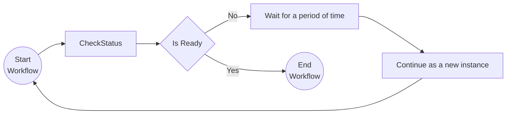

# Monitor Pattern

This tutorial demonstrates how to run a workflow in a loop. This can be used for recurring tasks that need to be executed on a certain frequency (e.g. a clean-up job that runs every hour). For more information on the monitor pattern see the [Dapr docs](https://docs.dapr.io/developing-applications/building-blocks/workflow/workflow-patterns/#monitor).

## Inspect the code

Open the `workflow.go` file in the `tutorials/workflow/go/monitor-pattern/monitor` folder. This file contains the definition for the workflow that calls the `CheckStatus` activity to check if a fictional resource is ready. The `CheckStatus` activity uses a random number generator to simulate the status of the resource. If the status is not ready, the workflow waits for a durable timer of two seconds with `ctx.CreateTimer` and then calls `ctx.ContinueAsNew` to continue as a new instance with a higher counter.

The `main.go` file in the same folder registers the workflow and the activity, starts the workflow worker, and exposes the `POST /start/{counter}` endpoint that schedules a workflow instance.



## Run the tutorial

1. Use a terminal to navigate to the `tutorials/workflow/go/monitor-pattern` folder.
2. Use the Dapr CLI to run the Dapr Multi-App run file. The first run downloads the Go dependencies, which can take a minute.

    <!-- STEP
    name: Run multi app run template
    expected_stdout_lines:
    - 'Started Dapr with app id "monitor"'
    expected_stderr_lines:
    working_dir: .
    output_match_mode: substring
    background: true
    sleep: 60
    timeout_seconds: 120
    -->
    ```bash
    dapr run -f .
    ```
    <!-- END_STEP -->

3. Use the POST request in the [`monitor.http`](./monitor.http) file to start the workflow, or use this cURL command:

    ```bash
    curl -i --request POST http://localhost:5257/start/0
    ```

    Note the `instance_id` property in the response. This property contains the workflow instance ID. You can use this ID to get the status of the workflow instance you just started.

    The input for the workflow is an integer with the value `0`.

    The expected app logs are as follows:

    ```text
    check_status: Received input: 0.
    check_status: Received input: 1.
    check_status: Received input: 2.
    check_status: Received input: 3.
    ```

    *Note that the number of app log statements can vary due to the randomization in the `CheckStatus` activity.*

4. Use the GET request in the [`monitor.http`](./monitor.http) file to get the status of the workflow, or use this cURL command:

    ```bash
    curl --request GET --url http://localhost:3557/v1.0/workflows/dapr/<INSTANCEID>
    ```

    Where `<INSTANCEID>` is the workflow instance ID you received in the `instance_id` property of the response in the previous step.

    The expected serialized output of the workflow is:

    ```txt
    "\"Status is healthy after 3 times.\""
    ```

    *The actual number of checks can vary since some randomization is used in the `CheckStatus` activity.*

5. Stop the Dapr Multi-App run process by pressing `Ctrl+C`.

## Run without Docker

By default, the tutorial uses Redis in Docker as the workflow state store, and the Dapr Placement and Scheduler services in Docker. You can run the tutorial without Docker and Redis and instead run the Dapr binaries as processes, and use an SQLite file to keep the workflow state.

Use this option when Docker is not available or not allowed, for example on a locked-down laptop, in a CI job, or in a dev container without Docker. It also starts faster, because it has fewer moving parts.

The commands are for Linux and macOS, and for Windows (PowerShell).

### Prerequisites without Docker and Redis

- [Dapr CLI](https://docs.dapr.io/getting-started/install-dapr-cli/). You do not need `dapr init` with Docker. Step 1 installs the binaries.
- [Go](https://go.dev/doc/install)
- SQLite needs no install. `daprd` includes the SQLite state store.

1. Install the Dapr binaries with `dapr init --slim`. This command installs `daprd`, `placement`, and `scheduler` in `$HOME/.dapr/bin` (`$env:USERPROFILE\.dapr\bin` on Windows, with the `.exe` extension). It does not start them.
2. Open a terminal in this folder and start the Scheduler service.

    Linux and macOS:

    ```bash
    $HOME/.dapr/bin/scheduler --etcd-data-dir ./scheduler-data
    ```

    Windows (PowerShell):

    ```powershell
    & "$env:USERPROFILE\.dapr\bin\scheduler.exe" --etcd-data-dir .\scheduler-data --port 6060
    ```

    On Windows, `dapr run` connects to the Scheduler service on port 6060 and to the Placement service on port 6050. On Linux and macOS, it uses ports 50006 and 50005. For this reason, the Windows commands set `--port`.

3. Open a second terminal in this folder and start the Placement service. It uses other ports than the Scheduler service, which uses ports 8080 and 9090 by default.

    Linux and macOS:

    ```bash
    $HOME/.dapr/bin/placement --healthz-port 8081 --metrics-port 9091
    ```

    Windows (PowerShell):

    ```powershell
    & "$env:USERPROFILE\.dapr\bin\placement.exe" --healthz-port 8081 --metrics-port 9091 --port 6050
    ```

    On Dapr 1.19 and later, you can skip this step. Then add `--placement-enabled=true` to the Scheduler command in step 2.

4. Open a third terminal in this folder and run the tutorial with the run file `dapr-sqlite.yaml`:

    ```bash
    dapr run -f dapr-sqlite.yaml
    ```

    Then follow steps 3 to 5 of the section "Run the tutorial".

`dapr-sqlite.yaml` is the same as `dapr.yaml`, but its `resourcesPath` points to the [`resources-sqlite`](../../resources-sqlite/) folder. That folder has a SQLite state store with `actorStateStore` set to `"true"`.

## Files

```
monitor-pattern/
├── README.md             # this file
├── dapr.yaml             # `dapr run -f .` config (appID, resources, command)
├── dapr-sqlite.yaml      # same, with the SQLite state store
├── monitor.http          # the requests of this tutorial
├── makefile              # wires the tutorial into `make validate`
├── go.mod                # module and dependencies
├── go.sum
└── monitor/
    ├── main.go           # registry, worker, and the HTTP endpoint
    └── workflow.go       # the workflow and the activity
```
