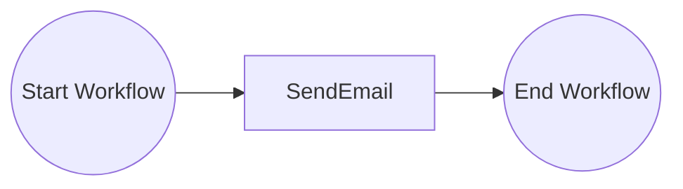
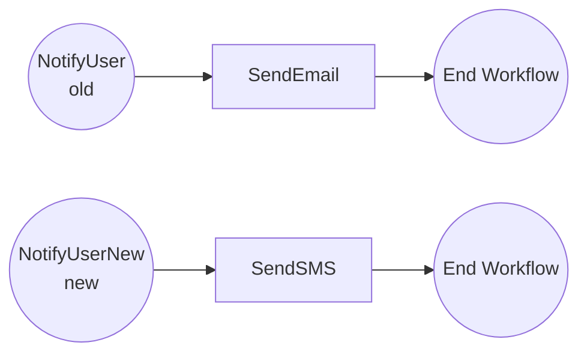
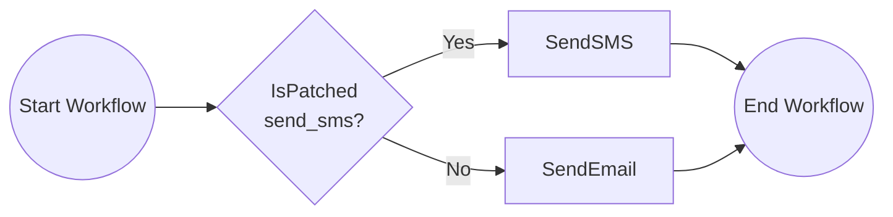

# Versioning Workflows

This tutorial demonstrates how to version your workflows. For more information about workflow versioning see the [Dapr docs](https://docs.dapr.io/developing-applications/building-blocks/workflow/workflow-features-concepts/#versioning).

This tutorial uses a scenario where a `NotifyUser` workflow initially sends an email to users. The workflow is then updated to send an SMS instead. Two versioning strategies are demonstrated: **named versions** and **patching**.

## Inspect the code

The `tutorials/workflow/go/versioning/versioning` folder has one Go package with these files:

- `main.go` registers the activities, starts the workflow worker, and exposes the `POST /start` endpoint that schedules a `NotifyUser` instance. The three stages below share it.
- `activities.go` has the `SendEmail` and `SendSMS` activities.
- `before.go`, `after_named_version.go`, and `after_patching.go` each hold one stage of the workflow and the `registerWorkflows` function that registers it. A [Go build tag](https://pkg.go.dev/cmd/go#hdr-Build_constraints) at the top of each file selects the stage, so the package builds with exactly one of them.

### Inspect the original workflow

Open the `before.go` file. This file contains the original workflow definition that sends an email to notify a user. It is the default stage.



### Inspect the named versioned workflow

Review the `after_named_version.go` file. This file shows how to create a new workflow version using named versions. A new version of the workflow (`NotifyUserNew`) is created that calls the `SendSMS` activity, while the original version is kept as `NotifyUser` for any workflow instances that might already be running. Both versions are registered with `AddVersionedWorkflow` under the same workflow name, `NotifyUser`. The version name is the name of the Go function, and the boolean argument marks the latest version.



The workflow engine will always execute the latest version of the workflow when new instances are started. Older versions will only be executed for workflows that were already in-flight when the update was deployed.

### Inspect the patching workflow

Review the `after_patching.go` file. This file shows how to create a new workflow version using patching. The `ctx.IsPatched("send_sms")` check determines whether the workflow should execute the new `SendSMS` activity or the original `SendEmail` activity based on if the patch `send_sms` is applied.



New workflow instances will execute the patched code path (`SendSMS`) since the workflow has already had a patch applied, while already started, in-flight workflows will continue using the original code path (`SendEmail`).

## Run the tutorial

1. Use a terminal to navigate to the `tutorials/workflow/go/versioning` folder.
2. By default, the `dapr.yaml` file is set to run the original workflow in `before.go`:

    ```yaml
    command: ["go", "run", "."]
    ```

   To try a versioned workflow, change the `command` field in this file to one of the following, depending on which version you'd like to run:

    - For the named version example (`after_named_version.go`):
      ```yaml
      command: ["go", "run", "-tags", "named_version", "."]
      ```
    - For the patching version example (`after_patching.go`):
      ```yaml
      command: ["go", "run", "-tags", "patching", "."]
      ```

   Make sure to save the file after making your changes. The same change applies to `dapr-sqlite.yaml` when you run without Docker.

3. Use the Dapr CLI to run the Dapr Multi-App run file. The first run downloads the Go dependencies, which can take a minute.

    <!-- STEP
    name: Run multi app run template
    expected_stdout_lines:
    - 'Started Dapr with app id "versioning"'
    expected_stderr_lines:
    working_dir: .
    output_match_mode: substring
    background: true
    sleep: 60
    timeout_seconds: 120
    -->
    ```bash
    dapr run -f .
    ```
    <!-- END_STEP -->

4. Use the POST request in the [`versioning.http`](./versioning.http) file to start the workflow, or use this cURL command:

    ```bash
    curl -i --request POST http://localhost:5263/start
    ```

    Note the `instance_id` property in the response. This property contains the workflow instance ID.

    When running the original workflow, the expected app logs are:

    ```text
    send_email: Received input: user_id.
    ```

    When running `after_named_version.go` or `after_patching.go`, the expected app logs change from `send_email` to `send_sms` and are:

    ```text
    send_sms: Received input: user_id.
    ```

5. Use the GET request in the [`versioning.http`](./versioning.http) file to get the status of the workflow, or use this cURL command:

    ```bash
    curl --request GET --url http://localhost:3561/v1.0/workflows/dapr/<INSTANCEID>
    ```

    Where `<INSTANCEID>` is the workflow instance ID you received in the `instance_id` property in the previous step.

    The expected serialized output of the workflow is:

    ```txt
    "\"Sent email to user_id\""
    ```

    For the two versioned workflows, the expected serialized output is `"\"Sent SMS to user_id\""`.

6. Stop the Dapr Multi-App run process by pressing `Ctrl+C`.

## Run without Docker

By default, the tutorial uses Redis in Docker as the workflow state store, and the Dapr Placement and Scheduler services in Docker. You can run the tutorial without Docker and Redis and instead run the Dapr binaries as processes, and use an SQLite file to keep the workflow state.

Use this option when Docker is not available or not allowed, for example on a locked-down laptop, in a CI job, or in a dev container without Docker. It also starts faster, because it has fewer moving parts.

The commands are for Linux and macOS, and for Windows (PowerShell).

### Prerequisites without Docker and Redis

- [Dapr CLI](https://docs.dapr.io/getting-started/install-dapr-cli/). You do not need `dapr init` with Docker. Step 1 installs the binaries.
- [Go](https://go.dev/doc/install)
- SQLite needs no install. `daprd` includes the SQLite state store.

1. Install the Dapr binaries with `dapr init --slim`. This command installs `daprd`, `placement`, and `scheduler` in `$HOME/.dapr/bin` (`$env:USERPROFILE\.dapr\bin` on Windows, with the `.exe` extension). It does not start them.
2. Open a terminal in this folder and start the Scheduler service.

    Linux and macOS:

    ```bash
    $HOME/.dapr/bin/scheduler --etcd-data-dir ./scheduler-data
    ```

    Windows (PowerShell):

    ```powershell
    & "$env:USERPROFILE\.dapr\bin\scheduler.exe" --etcd-data-dir .\scheduler-data --port 6060
    ```

    On Windows, `dapr run` connects to the Scheduler service on port 6060 and to the Placement service on port 6050. On Linux and macOS, it uses ports 50006 and 50005. For this reason, the Windows commands set `--port`.

3. Open a second terminal in this folder and start the Placement service. It uses other ports than the Scheduler service, which uses ports 8080 and 9090 by default.

    Linux and macOS:

    ```bash
    $HOME/.dapr/bin/placement --healthz-port 8081 --metrics-port 9091
    ```

    Windows (PowerShell):

    ```powershell
    & "$env:USERPROFILE\.dapr\bin\placement.exe" --healthz-port 8081 --metrics-port 9091 --port 6050
    ```

    On Dapr 1.19 and later, you can skip this step. Then add `--placement-enabled=true` to the Scheduler command in step 2.

4. Open a third terminal in this folder and run the tutorial with the run file `dapr-sqlite.yaml`:

    ```bash
    dapr run -f dapr-sqlite.yaml
    ```

    Then follow steps 3 to 6 of the section "Run the tutorial".

`dapr-sqlite.yaml` is the same as `dapr.yaml`, but its `resourcesPath` points to the [`resources-sqlite`](../../resources-sqlite/) folder. That folder has a SQLite state store with `actorStateStore` set to `"true"`.

## Files

```
versioning/
├── README.md                 # this file
├── dapr.yaml                 # `dapr run -f .` config (appID, resources, command)
├── dapr-sqlite.yaml          # same, with the SQLite state store
├── versioning.http           # the requests of this tutorial
├── makefile                  # wires the tutorial into `make validate`
├── go.mod                    # module and dependencies
├── go.sum
└── versioning/
    ├── main.go                   # registry, worker, and the HTTP endpoint
    ├── activities.go             # the SendEmail and SendSMS activities
    ├── before.go                 # stage 1: the original workflow (default)
    ├── after_named_version.go    # stage 2: named versions (build tag `named_version`)
    └── after_patching.go         # stage 3: patching (build tag `patching`)
```
