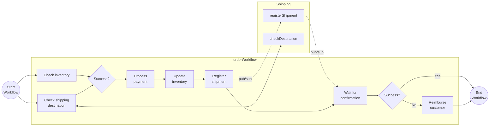

# Combined Workflow Patterns

This tutorial demonstrates how several workflow patterns can be combined in a single, more realistic, workflow with the Dapr JavaScript SDK. Some of the workflow activities are using other Dapr APIs, such as state management, service invocation, and Pub/Sub.

## Inspect the code

The demo consist of two applications:

- `workflow-app` is the main application that orchestrates an order process in the `orderWorkflow`. The workflow and the activities are in `workflow-app/src/orderWorkflow.ts`. The `app.ts` file registers them, and has the HTTP endpoints.
- `shipping-app` is a supporting service that is being called by the `orderWorkflow`.

The `orderWorkflow` combines task chaining, fan-out/fan-in, and waiting for external event patterns. The workflow contains a number of activities for order processing including checking inventory, register shipment, process payment and more with a final order status being returned with the results of the order. It uses compensating logic in case the shipment fails to get registered and the customer needs to be reimbursed for the payment.



## Prerequisites

- [Docker Desktop](https://www.docker.com/products/docker-desktop/).
- [Dapr CLI](https://docs.dapr.io/getting-started/install-dapr-cli/) & [Initialization](https://docs.dapr.io/getting-started/install-dapr-selfhost/)
- [Node.js](https://nodejs.org/en/download/) 20 or later.
- Optional: An IDE such as [VSCode](https://code.visualstudio.com/download) with a [REST client](https://marketplace.visualstudio.com/items?itemName=humao.rest-client).

## Run the tutorial

1. Use a terminal to navigate to the `tutorials/workflow/javascript/combined-patterns` folder.
2. Install the dependencies of both apps and compile the TypeScript code:

    <!-- STEP
    name: Install and build
    working_dir: .
    timeout_seconds: 300
    -->
    ```bash
    cd workflow-app
    npm install
    npm run build
    cd ../shipping-app
    npm install
    npm run build
    cd ..
    ```
    <!-- END_STEP -->

3. Use the Dapr CLI to run the Dapr Multi-App run file. This starts both applications `order-workflow` and `shipping` with the Dapr components in the [resources](./resources) folder.

    <!-- STEP
    name: Run multi app run template
    expected_stdout_lines:
    - 'Started Dapr with app id "order-workflow"'
    - 'Started Dapr with app id "shipping"'
    expected_stderr_lines:
    working_dir: .
    output_match_mode: substring
    background: true
    sleep: 15
    timeout_seconds: 30
    -->
    ```bash
    dapr run -f .
    ```
    <!-- END_STEP -->

4. Use the POST request in the [`order-workflow.http`](./order-workflow.http) file to start the workflow, or use this cURL command:

    ```bash
    curl -i --request POST \
    --url http://localhost:5260/start \
    --header 'content-type: application/json' \
    --data '{"id": "b0d38481-5547-411e-ae7b-255761cce17a","order_item" : {"product_id": "RBD001","product_name": "Rubber Duck","quantity": 10,"total_price": 15.00},"customer_info" : {"id" : "Customer1","country" : "The Netherlands"}}'
    ```

    The input for the workflow is an `Order` object:

    ```json
    {
        "id": "b0d38481-5547-411e-ae7b-255761cce17a",
        "order_item" : {
            "product_id": "RBD001",
            "product_name": "Rubber Duck",
            "quantity": 10,
            "total_price": 15.00
        },
        "customer_info" : {
            "id" : "Customer1",
            "country" : "The Netherlands"
        }
    }
    ```

    The app logs should come from both services executing all activities as follows. The two `registerShipment` lines are from different apps: the first one is the `registerShipment` activity of `workflow-app`, and the second one is the `/registerShipment` endpoint of `shipping-app`.

    ```text
    start: Received input: {"id":"b0d38481-5547-411e-ae7b-255761cce17a","order_item":{"product_id":"RBD001","product_name":"Rubber Duck","quantity":10,"total_price":15},"customer_info":{"id":"Customer1","country":"The Netherlands"}}.
    orderWorkflow: Received order id: b0d38481-5547-411e-ae7b-255761cce17a.
    checkInventory: Received input: {"product_id":"RBD001","product_name":"Rubber Duck","quantity":10,"total_price":15}.
    getInventoryItem: {"product_id":"RBD001","product_name":"Rubber Duck","quantity":50}
    checkShippingDestination: Received input: {"id":"Customer1","country":"The Netherlands"}.
    checkDestination: Received input: {"id":"Customer1","country":"The Netherlands"}.
    processPayment: Received input: {"id":"b0d38481-5547-411e-ae7b-255761cce17a","order_item":{"product_id":"RBD001","product_name":"Rubber Duck","quantity":10,"total_price":15},"customer_info":{"id":"Customer1","country":"The Netherlands"}}.
    orderWorkflow: Payment result: {"is_success":true}.
    updateInventory: Received input: {"product_id":"RBD001","product_name":"Rubber Duck","quantity":10,"total_price":15}.
    getInventoryItem: {"product_id":"RBD001","product_name":"Rubber Duck","quantity":50}
    registerShipment: Received input: {"id":"b0d38481-5547-411e-ae7b-255761cce17a","order_item":{"product_id":"RBD001","product_name":"Rubber Duck","quantity":10,"total_price":15},"customer_info":{"id":"Customer1","country":"The Netherlands"}}.
    registerShipment: Received input: {"customer_info":{"country":"The Netherlands","id":"Customer1"},"id":"b0d38481-5547-411e-ae7b-255761cce17a","order_item":{"product_id":"RBD001","product_name":"Rubber Duck","quantity":10,"total_price":15}}.
    shipmentRegistered: Received input: {"is_success":true,"order_id":"b0d38481-5547-411e-ae7b-255761cce17a"}.
    ```

5. Use the GET request in the [`order-workflow.http`](./order-workflow.http) file to get the status of the workflow, or use this cURL command:

    ```bash
    curl --request GET --url http://localhost:3560/v1.0/workflows/dapr/b0d38481-5547-411e-ae7b-255761cce17a
    ```

    The expected serialized output of the workflow is:

    ```txt
    "{\"is_success\":true,\"message\":\"Order b0d38481-5547-411e-ae7b-255761cce17a processed successfully.\"}"
    ```

    *If the order-workflow.http is used, the order_id is generated when making the request and is different each time.*

6. Stop the Dapr Multi-App run process by pressing `Ctrl+C`.
