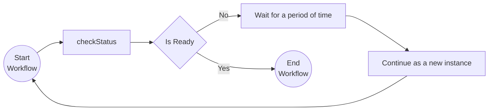

# Monitor Pattern

This tutorial demonstrates how to run a workflow in a loop with the Dapr JavaScript SDK. This can be used for recurring tasks that need to be executed on a certain frequency (e.g. a clean-up job that runs every hour). For more information on the monitor pattern see the [Dapr docs](https://docs.dapr.io/developing-applications/building-blocks/workflow/workflow-patterns/#monitor).

## Inspect the code

Open the `monitorWorkflow.ts` file in the `tutorials/workflow/javascript/monitor-pattern/monitor/src` folder. This file contains the definition for the workflow that calls the `checkStatus` activity to check if a fictional resource is ready. The `checkStatus` activity uses a random number generator to simulate the status of the resource. If the status is not ready, the workflow waits for two seconds with a durable timer, and is then continued as a new instance. The `app.ts` file registers the workflow and the activity, and has the HTTP endpoint that starts the workflow.



## Prerequisites

- [Docker Desktop](https://www.docker.com/products/docker-desktop/).
- [Dapr CLI](https://docs.dapr.io/getting-started/install-dapr-cli/) & [Initialization](https://docs.dapr.io/getting-started/install-dapr-selfhost/)
- [Node.js](https://nodejs.org/en/download/) 20 or later.
- Optional: An IDE such as [VSCode](https://code.visualstudio.com/download) with a [REST client](https://marketplace.visualstudio.com/items?itemName=humao.rest-client).

To run without Docker, see [Run without Docker](#run-without-docker).

## Run the tutorial

1. Use a terminal to navigate to the `tutorials/workflow/javascript/monitor-pattern` folder.
2. Install the dependencies and compile the TypeScript code:

    <!-- STEP
    name: Install and build
    working_dir: .
    timeout_seconds: 300
    -->
    ```bash
    cd monitor
    npm install
    npm run build
    cd ..
    ```
    <!-- END_STEP -->

3. Use the Dapr CLI to run the Dapr Multi-App run file

    <!-- STEP
    name: Run multi app run template
    expected_stdout_lines:
    - 'Started Dapr with app id "monitor"'
    expected_stderr_lines:
    working_dir: .
    output_match_mode: substring
    background: true
    sleep: 15
    timeout_seconds: 30
    -->
    ```bash
    dapr run -f .
    ```
    <!-- END_STEP -->

4. Use the POST request in the [`monitor.http`](./monitor.http) file to start the workflow, or use this cURL command:

    ```bash
    curl -i --request POST http://localhost:5257/start/0
    ```

    Note the `instance_id` property in the response. This property contains the workflow instance ID. You can use this ID to get the status of the workflow instance you just started.

    The input for the workflow is an integer with the value `0`.

    The expected app logs are as follows:

    ```text
    checkStatus: Received input: 0.
    checkStatus: Received input: 1.
    checkStatus: Received input: 2.
    checkStatus: Received input: 3.
    ```

    *Note that the number of app log statements can vary due to the randomization in the `checkStatus` activity.*

5. Use the GET request in the [`monitor.http`](./monitor.http) file to get the status of the workflow, or use this cURL command:

    ```bash
    curl --request GET --url http://localhost:3557/v1.0/workflows/dapr/<INSTANCEID>
    ```

    Where `<INSTANCEID>` is the workflow instance ID you received in the `instance_id` property of the response in the previous step.

    The expected serialized output of the workflow is:

    ```txt
    "\"Status is healthy after 3 times.\""
    ```

    *The actual number of checks can vary since some randomization is used in the `checkStatus` activity.*

6. Stop the Dapr Multi-App run process by pressing `Ctrl+C`.

## Run without Docker

By default, the tutorial uses Redis in Docker as the workflow state store, and the Dapr Placement and Scheduler services in Docker. You can run the tutorial without Docker and Redis and instead run the Dapr binaries as processes, and use an SQLite file to keep the workflow state.

Use this option when Docker is not available or not allowed, for example on a locked-down laptop, in a CI job, or in a dev container without Docker. It also starts faster, because it has fewer moving parts.

The commands are for Linux and macOS, and for Windows (PowerShell).

You need the [Dapr CLI](https://docs.dapr.io/getting-started/install-dapr-cli/) and [Node.js](https://nodejs.org/en/download/) 20 or later. You do not need `dapr init` with Docker. Step 1 installs the binaries. SQLite needs no install. `daprd` includes the SQLite state store.

1. Install the Dapr binaries. This command installs `daprd`, `placement`, and `scheduler` in `$HOME/.dapr/bin` (`$env:USERPROFILE\.dapr\bin` on Windows, with the `.exe` extension). It does not start them.

    ```bash
    dapr init --slim
    ```

2. Open a terminal in the `tutorials/workflow/javascript/monitor-pattern` folder and start the Scheduler service.

    Linux and macOS:

    ```bash
    $HOME/.dapr/bin/scheduler --etcd-data-dir ./scheduler-data
    ```

    Windows (PowerShell):

    ```powershell
    & "$env:USERPROFILE\.dapr\bin\scheduler.exe" --etcd-data-dir .\scheduler-data --port 6060
    ```

    On Windows, `dapr run` connects to the Scheduler service on port 6060 and to the Placement service on port 6050. On Linux and macOS, it uses ports 50006 and 50005. For this reason, the Windows commands set `--port`.

3. Open a second terminal in the same folder and start the Placement service. The Placement service and the Scheduler service both use ports 8080 and 9090 by default, so this command sets other ports.

    Linux and macOS:

    ```bash
    $HOME/.dapr/bin/placement --healthz-port 8081 --metrics-port 9091
    ```

    Windows (PowerShell):

    ```powershell
    & "$env:USERPROFILE\.dapr\bin\placement.exe" --healthz-port 8081 --metrics-port 9091 --port 6050
    ```

    On Dapr 1.19 and later, you can skip this step. Then add `--placement-enabled=true` to the Scheduler command in step 2. The Scheduler service then serves actor placement.

4. Open a third terminal in the same folder. Follow steps 1 to 6 of [Run the tutorial](#run-the-tutorial), but start the app with the run file `dapr-sqlite.yaml` instead of `dapr.yaml`:

    ```bash
    dapr run -f dapr-sqlite.yaml
    ```

    `dapr-sqlite.yaml` is the same as `dapr.yaml`, but its `resourcesPath` points to the [`resources-sqlite`](../../resources-sqlite/) folder. That folder has a SQLite state store with `actorStateStore` set to `"true"`. `dapr run` connects to the Placement and Scheduler services on their default ports: 50005 and 50006 on Linux and macOS, 6050 and 6060 on Windows. The Windows commands above set these ports.

To start again with no workflow state, stop all processes and delete the `scheduler-data` folder and the `workflows.db` files in the app folders.
