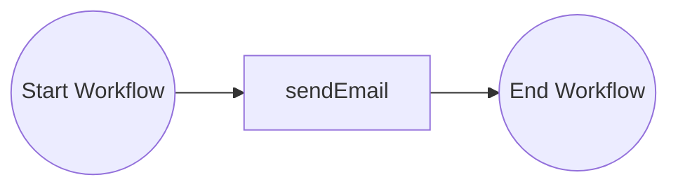
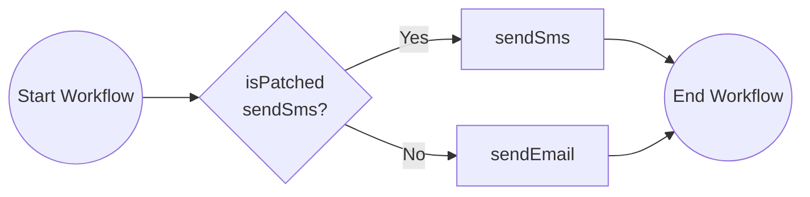

# Versioning Workflows

This tutorial demonstrates how to version your workflows with the Dapr JavaScript SDK. For more information about workflow versioning see the [Dapr docs](https://docs.dapr.io/developing-applications/building-blocks/workflow/workflow-features-concepts/#versioning).

This tutorial uses a scenario where a `notifyUser` workflow initially sends an email to users. The workflow is then updated to send an SMS instead. The update uses **patching**.

The Dapr JavaScript SDK (`@dapr/dapr` 3.19.0) has no API for **named versions**. For this reason, this tutorial has no named version example. The Python and Go tutorials have one.

## Inspect the original workflow

Open the `before.ts` file in the `tutorials/workflow/javascript/versioning/versioning/src` folder. This file contains the original workflow definition that sends an email to notify a user. The `app.ts` file has the HTTP endpoint that starts the workflow. Each stage file calls the `startApp` function of `app.ts` with its own workflow and its own registrations.



## Inspect the patching workflow

Review the `afterPatching.ts` file. This file shows how to create a new workflow version using patching. The `ctx.isPatched("sendSms")` check determines whether the workflow executes the new `sendSms` activity or the original `sendEmail` activity. The result depends on whether the patch `sendSms` is applied.



New workflow instances execute the patched code path (`sendSms`). Workflow instances that are already in flight continue to use the original code path (`sendEmail`). Keep the original code path until all the instances that need it have finished.

## Prerequisites

- [Docker Desktop](https://www.docker.com/products/docker-desktop/).
- [Dapr CLI](https://docs.dapr.io/getting-started/install-dapr-cli/) & [Initialization](https://docs.dapr.io/getting-started/install-dapr-selfhost/)
- [Node.js](https://nodejs.org/en/download/) 20 or later.
- Optional: An IDE such as [VSCode](https://code.visualstudio.com/download) with a [REST client](https://marketplace.visualstudio.com/items?itemName=humao.rest-client).

To run without Docker, see [Run without Docker](#run-without-docker).

## Run the tutorial

1. Use a terminal to navigate to the `tutorials/workflow/javascript/versioning` folder.
2. Install the dependencies and compile the TypeScript code:

    <!-- STEP
    name: Install and build
    working_dir: .
    timeout_seconds: 300
    -->
    ```bash
    cd versioning
    npm install
    npm run build
    cd ..
    ```
    <!-- END_STEP -->

3. By default, the `dapr.yaml` file is set to run `before.js`:

    ```yaml
    command: ["node", "dist/before.js"]
    ```

   To try the patched workflow, change the `command` field in this file to:

    ```yaml
    command: ["node", "dist/afterPatching.js"]
    ```

   Make sure to save the file after making your changes.

4. Use the Dapr CLI to run the Dapr Multi-App run file:

    <!-- STEP
    name: Run multi app run template
    expected_stdout_lines:
    - 'Started Dapr with app id "versioning"'
    expected_stderr_lines:
    working_dir: .
    output_match_mode: substring
    background: true
    sleep: 15
    timeout_seconds: 30
    -->
    ```bash
    dapr run -f .
    ```
    <!-- END_STEP -->

5. Use the POST request in the [`versioning.http`](./versioning.http) file to start the workflow, or use this cURL command:

    ```bash
    curl -i --request POST http://localhost:5263/start
    ```

    When running `before.js`, the expected app logs are:

    ```text
    send_email: Received input: user_id.
    ```

    When running `afterPatching.js`, the expected app logs change from `send_email` to `send_sms` and are:

    ```text
    send_sms: Received input: user_id.
    ```

6. Use the GET request in the [`versioning.http`](./versioning.http) file to get the status of the workflow, or use this cURL command:

    ```bash
    curl --request GET --url http://localhost:3561/v1.0/workflows/dapr/<INSTANCEID>
    ```

    Where `<INSTANCEID>` is the workflow instance ID you received in the `instance_id` property in the previous step.

    When running `before.js`, the expected serialized output of the workflow is:

    ```txt
    "\"Sent email to user_id\""
    ```

    When running `afterPatching.js`, the expected serialized output of the workflow is:

    ```txt
    "\"Sent SMS to user_id\""
    ```

    In the status response, this value is in the `properties` object, in the `dapr.workflow.output` field.

7. Stop the Dapr Multi-App run process by pressing `Ctrl+C`.

## Run without Docker

By default, the tutorial uses Redis in Docker as the workflow state store, and the Dapr Placement and Scheduler services in Docker. You can run the tutorial without Docker and Redis and instead run the Dapr binaries as processes, and use an SQLite file to keep the workflow state.

Use this option when Docker is not available or not allowed, for example on a locked-down laptop, in a CI job, or in a dev container without Docker. It also starts faster, because it has fewer moving parts.

The commands are for Linux and macOS, and for Windows (PowerShell).

You need the [Dapr CLI](https://docs.dapr.io/getting-started/install-dapr-cli/) and [Node.js](https://nodejs.org/en/download/) 20 or later. You do not need `dapr init` with Docker. Step 1 installs the binaries. SQLite needs no install. `daprd` includes the SQLite state store.

1. Install the Dapr binaries. This command installs `daprd`, `placement`, and `scheduler` in `$HOME/.dapr/bin` (`$env:USERPROFILE\.dapr\bin` on Windows, with the `.exe` extension). It does not start them.

    ```bash
    dapr init --slim
    ```

2. Open a terminal in the `tutorials/workflow/javascript/versioning` folder and start the Scheduler service.

    Linux and macOS:

    ```bash
    $HOME/.dapr/bin/scheduler --etcd-data-dir ./scheduler-data
    ```

    Windows (PowerShell):

    ```powershell
    & "$env:USERPROFILE\.dapr\bin\scheduler.exe" --etcd-data-dir .\scheduler-data --port 6060
    ```

    On Windows, `dapr run` connects to the Scheduler service on port 6060 and to the Placement service on port 6050. On Linux and macOS, it uses ports 50006 and 50005. For this reason, the Windows commands set `--port`.

3. Open a second terminal in the same folder and start the Placement service. The Placement service and the Scheduler service both use ports 8080 and 9090 by default, so this command sets other ports.

    Linux and macOS:

    ```bash
    $HOME/.dapr/bin/placement --healthz-port 8081 --metrics-port 9091
    ```

    Windows (PowerShell):

    ```powershell
    & "$env:USERPROFILE\.dapr\bin\placement.exe" --healthz-port 8081 --metrics-port 9091 --port 6050
    ```

    On Dapr 1.19 and later, you can skip this step. Then add `--placement-enabled=true` to the Scheduler command in step 2. The Scheduler service then serves actor placement.

4. Open a third terminal in the same folder. Follow steps 1 to 7 of [Run the tutorial](#run-the-tutorial), but start the app with the run file `dapr-sqlite.yaml` instead of `dapr.yaml`:

    ```bash
    dapr run -f dapr-sqlite.yaml
    ```

    `dapr-sqlite.yaml` is the same as `dapr.yaml`, but its `resourcesPath` points to the [`resources-sqlite`](../../resources-sqlite/) folder. That folder has a SQLite state store with `actorStateStore` set to `"true"`. `dapr run` connects to the Placement and Scheduler services on their default ports: 50005 and 50006 on Linux and macOS, 6050 and 6060 on Windows. The Windows commands above set these ports.

To start again with no workflow state, stop all processes and delete the `scheduler-data` folder and the `workflows.db` files in the app folders.
