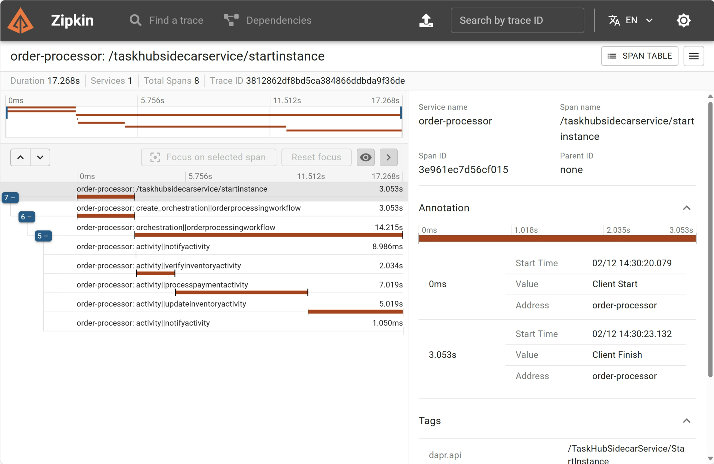

# Dapr workflows

In this quickstart, you'll run a console application to demonstrate Dapr's workflow programming model and the workflow management API. The console app starts and manages the lifecycle of a workflow that stores and retrieves data in a state store.

This quickstart includes one project:

- .NET console app `order-processor` 

The quickstart contains 1 workflow to simulate purchasing items from a store, and 5 unique activities within the workflow. These 5 activities are as follows:

- NotifyActivity: This activity utilizes a logger to print out messages throughout the workflow. These messages notify the user when there is insufficient inventory, their payment couldn't be processed, and more.
- VerifyInventoryActivity: This activity checks the state store to ensure that there is enough inventory present for purchase.
- RequestApprovalActivity: This activity is responsible requesting approval to purchase the order items in case the total cost is above a certain threshold.
- ProcessPaymentActivity: This activity is responsible for processing and authorizing the payment.
- UpdateInventoryActivity: This activity removes the requested items from the state store and updates the store with the new remaining inventory value.

### Run the order processor workflow

The app orders 2 cars at 5,000 each, so the total is 10,000. An order over 5,000 needs an approval, so the workflow waits for you to approve it. While it waits, you stop the app and start it again. The workflow continues from its saved history.

1. Open a terminal in this quickstart directory and set an order ID. The app uses it as the workflow instance ID.

    Linux and macOS:

    ```sh
    export ORDER_ID=order-$(date +%Y%m%d-%H%M%S)
    ```

    Windows (PowerShell):

    ```powershell
    $env:ORDER_ID = "order-$(Get-Date -Format yyyyMMdd-HHmmss)"
    ```

2. Build the app:

<!-- STEP
name: Install Dotnet dependencies
-->

```bash
cd ./order-processor
dotnet restore
dotnet build
```

<!-- END_STEP -->

3. Run the app with Dapr. Note that you may need to run `cd ..` to move the working directory up one to
'/workflows/csharp/sdk':

<!-- STEP
name: Run order-processor service
expected_stdout_lines:
  - "Order ID: order-validate"
  - "Started order order-validate."
  - "Approval requested for order order-validate. Waiting for approval."
  - "Workflow completed: COMPLETED"
expected_stderr_lines:
output_match_mode: substring
background: true
sleep: 30
timeout_seconds: 180
env:
  ORDER_ID: order-validate
-->

```bash
dapr run -f .
```

<!-- END_STEP -->

    The log shows `Order ID: <id>`, `Started order <id>.`, the activities before the approval, and then the request for approval:

    ```
    Order ID: order-20261024-101500
    Started order order-20261024-101500.
    Presenting notification Notification { Message = Received order order-20261024-101500 for 2 Cars at $10000 }
    Reserving inventory for order request ID 'order-20261024-101500' of 2 Cars
    There are: 10 Cars available for purchase
    Approval requested for order order-20261024-101500. Waiting for approval.
    ```

4. Stop the app with Ctrl+C.

5. Start the app again in the same terminal. `ORDER_ID` is still set.

    ```sh
    dapr run -f .
    ```

    The log shows `Order <id> is already running. Waiting for it to finish.` The activities before the approval do not run again.

6. In a second terminal, set `ORDER_ID` to the order ID that the app printed (`export ORDER_ID=<id>`, or `$env:ORDER_ID = "<id>"` in PowerShell). Then approve the order:

<!-- STEP
name: Approve the order
env:
  ORDER_ID: order-validate
expected_stdout_lines:
  - "Workflow 'order-validate' raised event 'ApprovalEvent' successfully"
output_match_mode: substring
sleep: 5
-->

```bash
dapr workflow raise-event $ORDER_ID/ApprovalEvent --app-id order-processor --input '{"approved": true}'
```

<!-- END_STEP -->

7. The first terminal shows the payment, the inventory update, and the end of the workflow:

    ```
    Order order-20261024-101500 is already running. Waiting for it to finish.
    Processing payment: request ID 'order-20261024-101500' for 2 Cars at $10000
    Payment for request ID 'order-20261024-101500' processed successfully
    There are now 8 Cars left in stock
    Presenting notification Notification { Message = Order order-20261024-101500 has completed! }
    Workflow completed: COMPLETED
    ```

The steps that finished before you stopped the app, the received order, the inventory check, and the request for approval, did not run again. The workflow continued from its history. A step that was in progress when you stopped the app can run again.

To stop the Dapr processes that `dapr run -f .` started, press Ctrl+C or run `dapr stop -f .`.

### Run without Docker

By default, the quickstart uses Redis in Docker as the workflow state store, and the Dapr Placement and Scheduler services in Docker. You can run the quickstart without Docker and Redis and instead run the Dapr binaries as processes, and use an SQLite file to keep the workflow state.

Use this option when Docker is not available or not allowed, for example on a locked-down laptop, in a CI job, or in a dev container without Docker. It also starts faster, because it has fewer moving parts.

The commands are for Linux and macOS, and for Windows (PowerShell).

#### Prerequisites without Docker and Redis

- [Dapr CLI](https://docs.dapr.io/getting-started/install-dapr-cli/). You do not need `dapr init` with Docker. Step 1 installs the binaries.
- The [.NET 10 SDK](https://dotnet.microsoft.com/download/dotnet/10.0) and the [.NET 8 runtime](https://dotnet.microsoft.com/download/dotnet/8.0). The build needs the .NET 10 SDK, because the Dapr state management source generator needs a newer compiler than the .NET 8 and .NET 9 SDKs have. The app targets `net8.0`, so it needs the .NET 8 runtime to run.
- SQLite needs no install. `daprd` includes the SQLite state store.

1. Install the Dapr binaries. This command installs `daprd`, `placement`, and `scheduler` in `$HOME/.dapr/bin` (`$env:USERPROFILE\.dapr\bin` on Windows, with the `.exe` extension). It does not start them.

    ```sh
    dapr init --slim
    ```

2. Open a terminal in this quickstart directory and start the Scheduler service.

    Linux and macOS:

    ```sh
    $HOME/.dapr/bin/scheduler --etcd-data-dir ./scheduler-data
    ```

    Windows (PowerShell):

    ```powershell
    & "$env:USERPROFILE\.dapr\bin\scheduler.exe" --etcd-data-dir .\scheduler-data --port 6060
    ```

    On Windows, `dapr run` connects to the Scheduler service on port 6060 and to the Placement service on port 6050. On Linux and macOS, it uses ports 50006 and 50005. For this reason, the Windows commands set `--port`.

3. Open a second terminal in the same directory and start the Placement service. The Placement service and the Scheduler service both use ports 8080 and 9090 by default, so this command sets other ports.

    Linux and macOS:

    ```sh
    $HOME/.dapr/bin/placement --healthz-port 8081 --metrics-port 9091
    ```

    Windows (PowerShell):

    ```powershell
    & "$env:USERPROFILE\.dapr\bin\placement.exe" --healthz-port 8081 --metrics-port 9091 --port 6050
    ```

    On Dapr 1.19 and later, you can skip this step. Then add `--placement-enabled=true` to the Scheduler command in step 2. The Scheduler service then serves actor placement.

4. Open a third terminal in the same directory and set an order ID:

    Linux and macOS:

    ```sh
    export ORDER_ID=order-$(date +%Y%m%d-%H%M%S)
    ```

    Windows (PowerShell):

    ```powershell
    $env:ORDER_ID = "order-$(Get-Date -Format yyyyMMdd-HHmmss)"
    ```

    Then build the app and run it with the run file `dapr-sqlite.yaml`:

    ```sh
    cd ./order-processor
    dotnet restore
    dotnet build
    cd ..
    dapr run -f dapr-sqlite.yaml
    ```

    The log shows `Order ID: <id>`, `Started order <id>.`, the activities before the approval, and then `Approval requested for order <id>. Waiting for approval.`

5. Stop the app with Ctrl+C. Start it again in the same terminal with `dapr run -f dapr-sqlite.yaml`. The log shows `Order <id> is already running. Waiting for it to finish.` The activities before the approval do not run again.

6. In a second terminal, set `ORDER_ID` to the order ID that the app printed (`export ORDER_ID=<id>`, or `$env:ORDER_ID = "<id>"` in PowerShell). Then approve the order:

    ```sh
    dapr workflow raise-event $ORDER_ID/ApprovalEvent --app-id order-processor --input '{"approved": true}'
    ```

    The first terminal shows the payment, the inventory update, and `Workflow completed: COMPLETED`. The finished steps did not run again, and the workflow continued from its history. A step that was in progress when you stopped the app can run again.

`dapr-sqlite.yaml` is the same as `dapr.yaml`, but its `resourcesPath` points to the [`components-sqlite`](../../components-sqlite/) folder. That folder has a SQLite state store with `actorStateStore` set to `"true"`. The expected output is the same as in the steps above.

To start again with no workflow state, stop all processes and delete the `scheduler-data` folder and the `workflows.db` file in the `order-processor` folder.

### View workflow output with Zipkin

For a more detailed view of the workflow activities (duration, progress etc.), try using Zipkin.

1. Launch Zipkin container - The [openzipkin/zipkin](https://hub.docker.com/r/openzipkin/zipkin/) docker container is launched on running `dapr init`. Check to make sure the container is running. If it's not, launch the Zipkin docker container with the following command.

```bash
docker run -d -p 9411:9411 openzipkin/zipkin
```

2. View Traces in Zipkin UI - In your browser go to http://localhost:9411 to view the workflow trace spans in the Zipkin web UI. The order-processor workflow should be viewable with the following output in the Zipkin web UI. 



### What happened? 

When you ran `dapr run -f .`:

1. The app read `ORDER_ID` and used it as the workflow instance ID. Without `ORDER_ID`, it uses `order-` and the local date and time.
2. The app wrote the inventory (10 cars) to the state store only because it was not there yet. A restart does not restock.
3. The app asked the Dapr sidecar for the state of the instance. The instance did not exist, so the app scheduled the workflow for an order of 2 cars at 5000 each.
4. The `NotifyActivity` workflow activity sent a notification for the new order.
5. The `VerifyInventoryActivity` workflow activity checked the inventory data and found enough cars.
6. The total cost of the order is 10000, which is over 5000, so the workflow called the `RequestApprovalActivity` activity and then waited for the `ApprovalEvent` event. The wait times out after 10 minutes.
7. When you started the app again, the instance existed and was not finished, so the app did not schedule a new one. It waited for the instance to finish.
8. The `dapr workflow raise-event` command sent `ApprovalEvent` with `{"approved": true}`. The workflow continued.
9. The `ProcessPaymentActivity` workflow activity processed the payment, and the `UpdateInventoryActivity` workflow activity updated the inventory.
10. The `NotifyActivity` workflow activity sent a notification that the order completed. The workflow ended as `COMPLETED`, and the app printed `Workflow completed: COMPLETED`.
