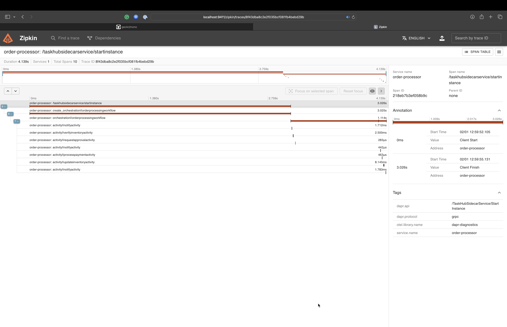

# Dapr workflows

In this quickstart, you'll create a simple console application to demonstrate Dapr's workflow programming model and the workflow client. The console app 
starts and manages an order processing workflow.
The workflow management API provided by the Dapr client can also be used interchangeably with minor adjustments

This quickstart includes one project:

- Go app `order-processor` 

The quickstart contains 1 workflow (OrderProcessingWorkflow) which simulates purchasing items from a store, and 5 unique activities within the workflow. These 5 
activities are as follows:

- NotifyActivity: This activity utilizes a logger to print out messages throughout the workflow. These messages notify the user when there is insufficient 
inventory, their payment couldn't be processed, and more.
- VerifyInventoryActivity: This activity checks the state store to ensure that there is enough inventory present for purchase.
- RequestApprovalActivity: This activity seeks approval from a manager, if payment is greater than 5000 USD.
- ProcessPaymentActivity: This activity is responsible for processing and authorizing the payment.
- UpdateInventoryActivity: This activity removes the requested items from the state store and updates the store with the new remaining inventory value.

### Run the order processor workflow

1. Open a new terminal window in this quickstart directory.
2. Run the console app with Dapr: 
<!-- STEP
name: Running this example
expected_stdout_lines:
  - "for 1 cars - $5000"
  - "There are 10 cars available for purchase"
  - "There are now 9 cars left in stock"
  - "workflow status: COMPLETED"
output_match_mode: substring
background: false
timeout_seconds: 120
sleep: 30
-->

```sh
dapr run -f .
```

<!-- END_STEP -->

3. Expected output

```
*** Welcome to the Dapr Workflow console app sample!
*** Using this app, you can place orders that start workflows.
dapr client initializing for: 127.0.0.1:46533
INFO: 2025/02/13 13:18:33 connecting work item listener stream
2025/02/13 13:18:33 work item listener started
INFO: 2025/02/13 13:18:33 starting background processor
adding base stock item: paperclip
adding base stock item: cars
adding base stock item: computers
==========Begin the purchase of item:==========
NotifyActivity: Received order b4cb2687-1af0-4f8d-9659-eb6389c07ade for 1 cars - $5000
VerifyInventoryActivity: Verifying inventory for order b4cb2687-1af0-4f8d-9659-eb6389c07ade of 1 cars
VerifyInventoryActivity: There are 10 cars available for purchase
ProcessPaymentActivity: b4cb2687-1af0-4f8d-9659-eb6389c07ade for 1 - cars (5000USD)
UpdateInventoryActivity: Checking Inventory for order b4cb2687-1af0-4f8d-9659-eb6389c07ade for 1 * cars
UpdateInventoryActivity: There are now 9 cars left in stock
NotifyActivity: Order b4cb2687-1af0-4f8d-9659-eb6389c07ade has completed!
workflow status: COMPLETED
Purchase of item is complete
```

4. Stop Dapr workflow with CTRL-C or:

```sh
    dapr stop -f .
```

### Run without Docker

By default, the quickstart uses Redis in Docker as the workflow state store, and the Dapr Placement and Scheduler services in Docker. You can run the quickstart without Docker and Redis and instead run the Dapr binaries as processes, and use an SQLite file to keep the workflow state.

Use this option when Docker is not available or not allowed, for example on a locked-down laptop, in a CI job, or in a dev container without Docker. It also starts faster, because it has fewer moving parts.

The commands are for Linux and macOS, and for Windows (PowerShell).

#### Prerequisites without Docker and Redis

- [Dapr CLI](https://docs.dapr.io/getting-started/install-dapr-cli/). You do not need `dapr init` with Docker. Step 1 installs the binaries.
- [Go](https://go.dev/doc/install)
- SQLite needs no install. `daprd` includes the SQLite state store.

1. Install the Dapr binaries. This command installs `daprd`, `placement`, and `scheduler` in `$HOME/.dapr/bin` (`$env:USERPROFILE\.dapr\bin` on Windows, with the `.exe` extension). It does not start them.

    ```sh
    dapr init --slim
    ```

2. Open a terminal in this quickstart directory and start the Scheduler service.

    Linux and macOS:

    ```sh
    $HOME/.dapr/bin/scheduler --etcd-data-dir ./scheduler-data
    ```

    Windows (PowerShell):

    ```powershell
    & "$env:USERPROFILE\.dapr\bin\scheduler.exe" --etcd-data-dir .\scheduler-data --port 6060
    ```

    On Windows, `dapr run` connects to the Scheduler service on port 6060 and to the Placement service on port 6050. On Linux and macOS, it uses ports 50006 and 50005. For this reason, the Windows commands set `--port`.

3. Open a second terminal in the same directory and start the Placement service. The Placement service and the Scheduler service both use ports 8080 and 9090 by default, so this command sets other ports.

    Linux and macOS:

    ```sh
    $HOME/.dapr/bin/placement --healthz-port 8081 --metrics-port 9091
    ```

    Windows (PowerShell):

    ```powershell
    & "$env:USERPROFILE\.dapr\bin\placement.exe" --healthz-port 8081 --metrics-port 9091 --port 6050
    ```

    On Dapr 1.19 and later, you can skip this step. Then add `--placement-enabled=true` to the Scheduler command in step 2. The Scheduler service then serves actor placement.

4. Open a third terminal in the same directory and run the app with the run file `dapr-sqlite.yaml`:

    ```sh
    dapr run -f dapr-sqlite.yaml
    ```

`dapr-sqlite.yaml` is the same as `dapr.yaml`, but its `resourcesPath` points to the [`components-sqlite`](../../components-sqlite/) folder. That folder has a SQLite state store with `actorStateStore` set to `"true"`. The expected output is the same as in the steps above.

To start again with no workflow state, stop all processes and delete the `scheduler-data` folder and the `workflows.db` file in the `order-processor` folder.

### View workflow output with Zipkin

For a more detailed view of the workflow activities (duration, progress etc.), try using Zipkin.

1. View Traces in Zipkin UI - In your browser go to http://localhost:9411 to view the workflow trace spans in the Zipkin web UI. The order-processor workflow 
should be viewable with the following output in the Zipkin web UI. Note: the [openzipkin/zipkin](https://hub.docker.com/r/openzipkin/zipkin/) docker container is 
launched on running `dapr init`.



### What happened? 

When you ran the above commands:

1. An OrderPayload is made containing one car.
2. A unique order ID for the workflow is generated (in the above example, `b4cb2687-1af0-4f8d-9659-eb6389c07ade`) and the workflow is scheduled.
3. The `NotifyActivity` workflow activity sends a notification saying an order for 1 car has been received.
4. The `VerifyInventoryActivity` workflow activity checks the inventory data, determines if you can supply the ordered item, and responds with the number of cars in stock.
5. The total cost of the order is 5000, so the workflow will not call the `RequestApprovalActivity` activity.
6. The `ProcessPaymentActivity` workflow activity begins processing payment for order `b4cb2687-1af0-4f8d-9659-eb6389c07ade` and confirms if successful.
7. The `UpdateInventoryActivity` workflow activity updates the inventory with the current available cars after the order has been processed.
8. The `NotifyActivity` workflow activity sends a notification saying that order `b4cb2687-1af0-4f8d-9659-eb6389c07ade` has completed.
9. The workflow terminates as completed and the OrderResult is set to processed.

> **Note:** This quickstart uses an OrderPayload of one car with a total cost of $5000. Since the total order cost is not over 5000, the workflow will not call the `RequestApprovalActivity` activity nor wait for an approval event. Since the quickstart is a console application, it can't accept incoming events easily. If you want to test this scenario, convert the console app to a service and use the [raise event API](https://docs.dapr.io/reference/api/workflow_api/#raise-event-request) via HTTP/gRPC or via the Dapr Workflow client to send an event to the workflow instance.
