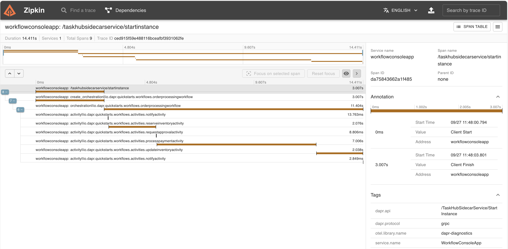

# Dapr workflows

In this quickstart, you'll run console application to demonstrate Dapr's workflow programming model and the workflow management API. The console app starts and manages the lifecycle of a workflow that stores and retrieves data in a state store.

This quickstart includes one project:

- Java console app `order-processor` 

The quickstart contains 1 workflow to simulate purchasing items from a store, and 5 unique activities within the workflow. These 5 activities are as follows:

- NotifyActivity: This activity utilizes a logger to print out messages throughout the workflow. These messages notify the user when there is insufficient inventory, their payment couldn't be processed, and more.
- VerifyInventoryActivity: This activity checks the state store to ensure that there is enough inventory present for purchase.
- RequestApprovalActivity: This activity requests approval for orders over a certain threshold.
- ProcessPaymentActivity: This activity is responsible for processing and authorizing the payment.
- UpdateInventoryActivity: This activity updates the state store with the new remaining inventory value.

### Run the order processor workflow

1. Open a new terminal window and navigate to `order-processor` directory: 

<!-- STEP
name: Install Java dependencies
-->

```bash
cd ./order-processor
mvn clean install
cd ..
```

<!-- END_STEP -->
2. Run the console app with Dapr: 

<!-- STEP
name: Run order-processor service
expected_stdout_lines:
  - 'there are now 9 cars left in stock'
  - 'Workflow instance completed, out is: {"processed":true}'
expected_stderr_lines:
output_match_mode: substring
background: true
sleep: 15
timeout_seconds: 120
-->
    
```bash
dapr run -f .
```

<!-- END_STEP -->

3. Expected output. The instance ID, the dates, the times and the ports differ on each run:

```
*** Welcome to the Dapr Workflow console app sample!
*** Using this app, you can place orders that start workflows.
[main] INFO io.dapr.workflows.runtime.WorkflowRuntimeBuilder - Registered Workflow: OrderProcessingWorkflow
[main] INFO io.dapr.workflows.runtime.WorkflowRuntimeBuilder - Registered Activity: NotifyActivity
[main] INFO io.dapr.workflows.runtime.WorkflowRuntimeBuilder - Registered Activity: ProcessPaymentActivity
[main] INFO io.dapr.workflows.runtime.WorkflowRuntimeBuilder - Registered Activity: RequestApprovalActivity
[main] INFO io.dapr.workflows.runtime.WorkflowRuntimeBuilder - Registered Activity: VerifyInventoryActivity
[main] INFO io.dapr.workflows.runtime.WorkflowRuntimeBuilder - Registered Activity: UpdateInventoryActivity
[main] INFO io.dapr.workflows.runtime.WorkflowRuntimeBuilder - List of registered workflows: [io.dapr.quickstarts.workflows.OrderProcessingWorkflow]
[main] INFO io.dapr.workflows.runtime.WorkflowRuntimeBuilder - List of registered activities: [io.dapr.quickstarts.workflows.activities.NotifyActivity, io.dapr.quickstarts.workflows.activities.UpdateInventoryActivity, io.dapr.quickstarts.workflows.activities.ProcessPaymentActivity, io.dapr.quickstarts.workflows.activities.RequestApprovalActivity, io.dapr.quickstarts.workflows.activities.VerifyInventoryActivity]
[main] INFO io.dapr.workflows.runtime.WorkflowRuntimeBuilder - Successfully built dapr workflow runtime
Start workflow runtime
Oct 24, 2026 12:37:00 AM io.dapr.durabletask.DurableTaskGrpcWorker startAndBlock
INFO: Durable Task worker is connecting to sidecar at 127.0.0.1:44409.
==========Begin the purchase of item:==========
Starting order workflow, purchasing 1 of cars
Oct 24, 2026 12:37:00 AM io.dapr.durabletask.orchestration.TaskOrchestrationFactories getOrchestrationFactory
INFO: Get orchestration factory for io.dapr.quickstarts.workflows.OrderProcessingWorkflow version
[pool-2-thread-1] INFO io.dapr.quickstarts.workflows.OrderProcessingWorkflow - Starting Workflow: io.dapr.quickstarts.workflows.OrderProcessingWorkflow
[pool-2-thread-1] INFO io.dapr.quickstarts.workflows.OrderProcessingWorkflow - Instance ID(order ID): cb027210-b3e3-4521-ab1e-c37404f3dac5
[pool-2-thread-1] INFO io.dapr.quickstarts.workflows.OrderProcessingWorkflow - Current Orchestration Time: 2026-10-24T00:37:00.408Z
[pool-2-thread-1] INFO io.dapr.quickstarts.workflows.OrderProcessingWorkflow - Received Order: OrderPayload [itemName=cars, totalCost=5000, quantity=1]
Scheduled new workflow instance of OrderProcessingWorkflow with instance ID: cb027210-b3e3-4521-ab1e-c37404f3dac5
Oct 24, 2026 12:37:00 AM io.dapr.durabletask.DurableTaskGrpcWorker startAndBlock
INFO: Processing activity request: io.dapr.quickstarts.workflows.activities.NotifyActivity for instance: cb027210-b3e3-4521-ab1e-c37404f3dac5, gRPC thread context: {}
[pool-2-thread-1] INFO io.dapr.quickstarts.workflows.activities.NotifyActivity - Received Order: OrderPayload [itemName=cars, totalCost=5000, quantity=1]
Workflow instance cb027210-b3e3-4521-ab1e-c37404f3dac5 started
Oct 24, 2026 12:37:00 AM io.dapr.durabletask.orchestration.TaskOrchestrationFactories getOrchestrationFactory
INFO: Get orchestration factory for io.dapr.quickstarts.workflows.OrderProcessingWorkflow version
Oct 24, 2026 12:37:00 AM io.dapr.durabletask.DurableTaskGrpcWorker startAndBlock
INFO: Processing activity request: io.dapr.quickstarts.workflows.activities.VerifyInventoryActivity for instance: cb027210-b3e3-4521-ab1e-c37404f3dac5, gRPC thread context: {}
[pool-2-thread-1] INFO io.dapr.quickstarts.workflows.activities.VerifyInventoryActivity - Verifying inventory for order 'cb027210-b3e3-4521-ab1e-c37404f3dac5' of 1 cars
[pool-2-thread-1] INFO io.dapr.quickstarts.workflows.activities.VerifyInventoryActivity - There are 10 cars available for purchase
[pool-2-thread-1] INFO io.dapr.quickstarts.workflows.activities.VerifyInventoryActivity - Verified inventory for order 'cb027210-b3e3-4521-ab1e-c37404f3dac5' of 1 cars
Oct 24, 2026 12:37:02 AM io.dapr.durabletask.orchestration.TaskOrchestrationFactories getOrchestrationFactory
INFO: Get orchestration factory for io.dapr.quickstarts.workflows.OrderProcessingWorkflow version
Oct 24, 2026 12:37:02 AM io.dapr.durabletask.DurableTaskGrpcWorker startAndBlock
INFO: Processing activity request: io.dapr.quickstarts.workflows.activities.ProcessPaymentActivity for instance: cb027210-b3e3-4521-ab1e-c37404f3dac5, gRPC thread context: {}
[pool-2-thread-1] INFO io.dapr.quickstarts.workflows.activities.ProcessPaymentActivity - Processing payment: cb027210-b3e3-4521-ab1e-c37404f3dac5 for 1 cars at $5000
[pool-2-thread-1] INFO io.dapr.quickstarts.workflows.activities.ProcessPaymentActivity - Payment for request ID 'cb027210-b3e3-4521-ab1e-c37404f3dac5' processed successfully
Oct 24, 2026 12:37:09 AM io.dapr.durabletask.orchestration.TaskOrchestrationFactories getOrchestrationFactory
INFO: Get orchestration factory for io.dapr.quickstarts.workflows.OrderProcessingWorkflow version
Oct 24, 2026 12:37:09 AM io.dapr.durabletask.DurableTaskGrpcWorker startAndBlock
INFO: Processing activity request: io.dapr.quickstarts.workflows.activities.UpdateInventoryActivity for instance: cb027210-b3e3-4521-ab1e-c37404f3dac5, gRPC thread context: {}
[pool-2-thread-1] INFO io.dapr.quickstarts.workflows.activities.UpdateInventoryActivity - Updating inventory for order 'cb027210-b3e3-4521-ab1e-c37404f3dac5' of 1 cars
[pool-2-thread-1] INFO io.dapr.quickstarts.workflows.activities.UpdateInventoryActivity - Updated inventory for order 'cb027210-b3e3-4521-ab1e-c37404f3dac5': there are now 9 cars left in stock
there are now 9 cars left in stock
Oct 24, 2026 12:37:11 AM io.dapr.durabletask.orchestration.TaskOrchestrationFactories getOrchestrationFactory
INFO: Get orchestration factory for io.dapr.quickstarts.workflows.OrderProcessingWorkflow version
Oct 24, 2026 12:37:11 AM io.dapr.durabletask.DurableTaskGrpcWorker startAndBlock
INFO: Processing activity request: io.dapr.quickstarts.workflows.activities.NotifyActivity for instance: cb027210-b3e3-4521-ab1e-c37404f3dac5, gRPC thread context: {}
[pool-2-thread-1] INFO io.dapr.quickstarts.workflows.activities.NotifyActivity - Order completed! : cb027210-b3e3-4521-ab1e-c37404f3dac5
Oct 24, 2026 12:37:11 AM io.dapr.durabletask.orchestration.TaskOrchestrationFactories getOrchestrationFactory
INFO: Get orchestration factory for io.dapr.quickstarts.workflows.OrderProcessingWorkflow version
Workflow instance completed, out is: {"processed":true}
```

4. Stop Dapr workflow with CTRL-C or:

```sh
dapr stop -f .
```

### Run without Docker

By default, the quickstart uses Redis in Docker as the workflow state store, and the Dapr Placement and Scheduler services in Docker. You can run the quickstart without Docker and Redis and instead run the Dapr binaries as processes, and use an SQLite file to keep the workflow state.

Use this option when Docker is not available or not allowed, for example on a locked-down laptop, in a CI job, or in a dev container without Docker. It also starts faster, because it has fewer moving parts.

The commands are for Linux and macOS, and for Windows (PowerShell).

#### Prerequisites without Docker and Redis

- [Dapr CLI](https://docs.dapr.io/getting-started/install-dapr-cli/). You do not need `dapr init` with Docker. Step 1 installs the binaries.
- [JDK and Maven](https://maven.apache.org/install.html)
- SQLite needs no install. `daprd` includes the SQLite state store.

1. Install the Dapr binaries. This command installs `daprd`, `placement`, and `scheduler` in `$HOME/.dapr/bin` (`$env:USERPROFILE\.dapr\bin` on Windows, with the `.exe` extension). It does not start them.

    ```sh
    dapr init --slim
    ```

2. Open a terminal in this quickstart directory and start the Scheduler service.

    Linux and macOS:

    ```sh
    $HOME/.dapr/bin/scheduler --etcd-data-dir ./scheduler-data
    ```

    Windows (PowerShell):

    ```powershell
    & "$env:USERPROFILE\.dapr\bin\scheduler.exe" --etcd-data-dir .\scheduler-data --port 6060
    ```

    On Windows, `dapr run` connects to the Scheduler service on port 6060 and to the Placement service on port 6050. On Linux and macOS, it uses ports 50006 and 50005. For this reason, the Windows commands set `--port`.

3. Open a second terminal in the same directory and start the Placement service. The Placement service and the Scheduler service both use ports 8080 and 9090 by default, so this command sets other ports.

    Linux and macOS:

    ```sh
    $HOME/.dapr/bin/placement --healthz-port 8081 --metrics-port 9091
    ```

    Windows (PowerShell):

    ```powershell
    & "$env:USERPROFILE\.dapr\bin\placement.exe" --healthz-port 8081 --metrics-port 9091 --port 6050
    ```

    On Dapr 1.19 and later, you can skip this step. Then add `--placement-enabled=true` to the Scheduler command in step 2. The Scheduler service then serves actor placement.

4. Open a third terminal in the same directory, build the app, and run it with the run file `dapr-sqlite.yaml`:

    ```sh
    cd ./order-processor
    mvn clean install
    cd ..
    dapr run -f dapr-sqlite.yaml
    ```

`dapr-sqlite.yaml` is the same as `dapr.yaml`, but its `resourcesPath` points to the [`components-sqlite`](../../components-sqlite/) folder. That folder has a SQLite state store with `actorStateStore` set to `"true"`. The expected output is the same as in the steps above.

To start again with no workflow state, stop all processes and delete the `scheduler-data` folder and the `workflows.db` file in the `order-processor/target` folder.

### View workflow output with Zipkin

For a more detailed view of the workflow activities (duration, progress etc.), try using Zipkin.

1. Launch Zipkin container - The [openzipkin/zipkin](https://hub.docker.com/r/openzipkin/zipkin/) docker container is launched on running `dapr init`. Check to make sure the container is running. If it's not, launch the Zipkin docker container with the following command.

```bash
docker run -d -p 9411:9411 openzipkin/zipkin
```

2. View Traces in Zipkin UI - In your browser go to http://localhost:9411 to view the workflow trace spans in the Zipkin web UI. The order-processor workflow should be viewable with the following output in the Zipkin web UI. 



### What happened? 

When you ran `dapr run -f .`:

1. An OrderPayload is made containing one car.
2. A unique order ID for the workflow is generated (in the above example, `d1bf548b-c854-44af-978e-90c61ed88e3c`) and the workflow is scheduled.
3. The `NotifyActivity` workflow activity sends a notification saying an order for one car has been received.
4. The `VertifyInventoryActivity` workflow activity checks the inventory data, determines if you can supply the ordered item, and responds with the number of cars in stock. The inventory is sufficient so the workflow continues.
5. The total cost of the order is 5000, so the workflow will not call the `RequestApprovalActivity` activity.
6. The `ProcessPaymentActivity` workflow activity begins processing payment for order `d1bf548b-c854-44af-978e-90c61ed88e3c` and confirms if successful.
7. The `UpdateInventoryActivity` workflow activity updates the inventory with the current available cars after the order has been processed.
8. The `NotifyActivity` workflow activity sends a notification saying that order `d1bf548b-c854-44af-978e-90c61ed88e3c` has completed.
9. The workflow terminates as completed and the orderResult is set to processed.

> **Note:** This quickstart uses an OrderPayload of one car with a total cost of $5000. Since the total order cost is not over 5000, the workflow will not call the `RequestApprovalActivity` activity nor wait for an approval event. Since the quickstart is a console application, it can't accept incoming events easily. If you want to test this scenario, convert the console app to a service and use the [raise event API](https://docs.dapr.io/reference/api/workflow_api/#raise-event-request) via HTTP/gRPC or via the Dapr Workflow client to send an event to the workflow instance.
