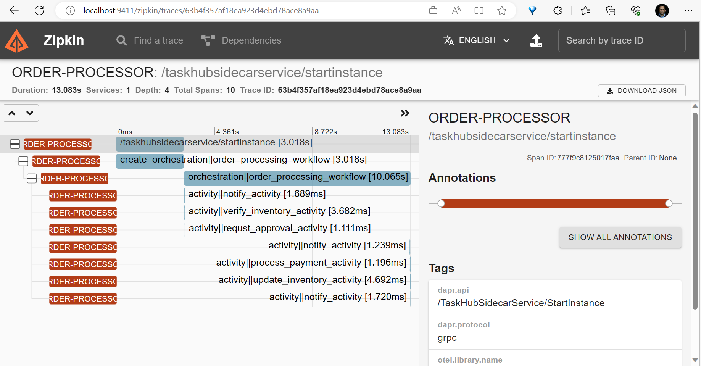

# Dapr workflows

In this quickstart, you'll create a simple console application to demonstrate Dapr's workflow programming model and the workflow management API. The console app starts and manages an order processing workflow.

This quickstart includes one project:

- Python console app `order-processor` 

The quickstart contains 1 workflow (order_processing_workflow) which simulates purchasing items from a store, and 5 unique activities within the workflow. These 5 activities are as follows:

- notify_activity: This activity utilizes a logger to print out messages throughout the workflow. These messages notify the user when there is insufficient inventory, their payment couldn't be processed, and more.
- process_payment_activity: This activity is responsible for processing and authorizing the payment.
- verify_inventory_activity: This activity checks the state store to ensure that there is enough inventory present for purchase.
- update_inventory_activity: This activity removes the requested items from the state store and updates the store with the new remaining inventory value.
- request_approval_activity: This activity seeks approval from Manager, if payment is greater than 5000 USD.

### Run the order processor workflow

The order in this quickstart is 2 cars at $5,000 each, a total of $10,000. An order over $5,000 needs approval, so the workflow waits for an approval event. You stop the app while the workflow waits, start it again, and then approve the order. The workflow continues from its history.

1. Open a new terminal window in this quickstart directory and install dependencies:

<!-- STEP
name: Install requirements
-->

```sh
uv sync
```

<!-- END_STEP -->

2. Set an order ID. The app uses it as the workflow instance ID. In PowerShell, use `$env:ORDER_ID = "order-$(Get-Date -Format yyyyMMdd-HHmmss)"`.

    ```sh
    export ORDER_ID=order-$(date +%Y%m%d-%H%M%S)
    ```

3. Run the console app with Dapr:

<!-- STEP
name: Run the order processor and approve the order
env:
  ORDER_ID: order-validate
expected_stdout_lines:
  - "Order ID: order-validate"
  - "Started order order-validate."
  - "Approval requested for order order-validate. Waiting for approval."
  - "Workflow completed: COMPLETED"
output_match_mode: substring
background: true
timeout_seconds: 120
sleep: 30
-->

```sh
uv run dapr run -f .
```

<!-- END_STEP -->

    The log shows the order ID and `Started order <id>.`. Then it shows the activities that run before the approval, and this line:

    ```
    Approval requested for order <id>. Waiting for approval.
    ```

4. Stop the app with CTRL-C. The workflow is not complete. Dapr keeps its state.

5. Start the app again in the same terminal. `ORDER_ID` is still set.

    ```sh
    uv run dapr run -f .
    ```

    The log shows this line. The activities that ran before the approval do not run again.

    ```
    Order <id> is already running. Waiting for it to finish.
    ```

6. In a second terminal, approve the order. Use the order ID that the app printed.

<!-- STEP
name: Approve the order
expected_stdout_lines:
  - "raised event 'ApprovalEvent' successfully"
output_match_mode: substring
-->

```sh
dapr workflow raise-event order-validate/ApprovalEvent --app-id order-processor --input '{"approved": true}'
```

<!-- END_STEP -->

    For your own order, replace `order-validate` with your order ID.

7. The first terminal shows the payment, the inventory update, and the end of the workflow:

    ```
    Processing payment: <id> for 2 cars at 10000 USD
    Payment for request ID <id> processed successfully
    Checking inventory for order <id> for 2 cars
    There are now 8 cars left in stock
    Order <id> has completed!
    Workflow completed: COMPLETED
    ```

    The steps that finished before the stop did not run again. The workflow continued from its history. A step that was in progress when you stopped the app can run again.

8. Stop the app with CTRL-C or:

    ```sh
    dapr stop -f .
    ```

If you start the app with an order ID that already ended, the app prints the status of that workflow and exits. Set a new `ORDER_ID` to place a new order.

### Run without Docker

By default, the quickstart uses Redis in Docker as the workflow state store, and the Dapr Placement and Scheduler services in Docker. You can run the quickstart without Docker and Redis and instead run the Dapr binaries as processes, and use an SQLite file to keep the workflow state.

Use this option when Docker is not available or not allowed, for example on a locked-down laptop, in a CI job, or in a dev container without Docker. It also starts faster, because it has fewer moving parts.

The commands are for Linux and macOS, and for Windows (PowerShell).

#### Prerequisites without Docker and Redis

- [Dapr CLI](https://docs.dapr.io/getting-started/install-dapr-cli/). You do not need `dapr init` with Docker. Step 1 installs the binaries.
- [uv](https://docs.astral.sh/uv/getting-started/installation/)
- SQLite needs no install. `daprd` includes the SQLite state store.

1. Install the Dapr binaries. This command installs `daprd`, `placement`, and `scheduler` in `$HOME/.dapr/bin` (`$env:USERPROFILE\.dapr\bin` on Windows, with the `.exe` extension). It does not start them.

    ```sh
    dapr init --slim
    ```

2. Open a terminal in this quickstart directory and start the Scheduler service.

    Linux and macOS:

    ```sh
    $HOME/.dapr/bin/scheduler --etcd-data-dir ./scheduler-data
    ```

    Windows (PowerShell):

    ```powershell
    & "$env:USERPROFILE\.dapr\bin\scheduler.exe" --etcd-data-dir .\scheduler-data --port 6060
    ```

    On Windows, `dapr run` connects to the Scheduler service on port 6060 and to the Placement service on port 6050. On Linux and macOS, it uses ports 50006 and 50005. For this reason, the Windows commands set `--port`.

3. Open a second terminal in the same directory and start the Placement service. The Placement service and the Scheduler service both use ports 8080 and 9090 by default, so this command sets other ports.

    Linux and macOS:

    ```sh
    $HOME/.dapr/bin/placement --healthz-port 8081 --metrics-port 9091
    ```

    Windows (PowerShell):

    ```powershell
    & "$env:USERPROFILE\.dapr\bin\placement.exe" --healthz-port 8081 --metrics-port 9091 --port 6050
    ```

    On Dapr 1.19 and later, you can skip this step. Then add `--placement-enabled=true` to the Scheduler command in step 2. The Scheduler service then serves actor placement.

4. Open a third terminal in the same directory and install the dependencies:

    ```sh
    uv sync
    ```

5. Set an order ID, and run the console app with the run file `dapr-sqlite.yaml`:

    ```sh
    export ORDER_ID=order-$(date +%Y%m%d-%H%M%S)
    uv run dapr run -f dapr-sqlite.yaml
    ```

    The log shows `Approval requested for order <id>. Waiting for approval.`

6. Stop the app with CTRL-C, and start it again in the same terminal. The log shows `Order <id> is already running. Waiting for it to finish.`

    ```sh
    uv run dapr run -f dapr-sqlite.yaml
    ```

7. In a fourth terminal, approve the order:

    ```sh
    dapr workflow raise-event <id>/ApprovalEvent --app-id order-processor --input '{"approved": true}'
    ```

    The terminal of the app shows `Workflow completed: COMPLETED`.

`dapr-sqlite.yaml` is the same as `dapr.yaml`, but its `resourcesPath` points to the [`components-sqlite`](../../components-sqlite/) folder. That folder has a SQLite state store with `actorStateStore` set to `"true"`. The expected output is the same as in the steps above. The workflow state is in the SQLite file, so the workflow continues after a restart.

To start again with no workflow state, stop all processes and delete the `scheduler-data` folder and the `workflows.db` file in the `order-processor` folder.

### View workflow output with Zipkin

For a more detailed view of the workflow activities (duration, progress etc.), try using Zipkin.

1. View Traces in Zipkin UI - In your browser go to http://localhost:9411 to view the workflow trace spans in the Zipkin web UI. The order-processor workflow should be viewable with the following output in the Zipkin web UI. Note: the [openzipkin/zipkin](https://hub.docker.com/r/openzipkin/zipkin/) docker container is launched on running `dapr init`. 



### What happened? 

When you ran `dapr run -f .`

1. The app makes an OrderPayload that contains two cars, with a total cost of $10,000.
2. The order ID, from `ORDER_ID`, is the workflow instance ID. The app checks if the workflow exists. When it does not exist, the app schedules it. When it exists and has not ended, the app waits for it. When it ended, the app prints its status and exits.
3. The `notify_activity` workflow activity sends a notification saying an order for two cars has been received.
4. The `verify_inventory_activity` workflow activity checks the inventory data, determines if you can supply the ordered item, and responds with the number of cars in stock. The inventory is sufficient so the workflow continues.
5. The total cost of the order is more than 5000, so the workflow calls the `request_approval_activity` activity. Then it waits for the `ApprovalEvent` event, for up to 10 minutes. When the time ends, the workflow cancels the order.
6. You stopped the app and started it again. The app found the workflow, and the workflow continued from its history. The activities that finished before the stop did not run again. The app writes the inventory only when it is not in the state store, so a restart does not restock it.
7. When you raised `ApprovalEvent` with `{"approved": true}`, the `process_payment_activity` workflow activity processed the payment for the order.
8. The `update_inventory_activity` workflow activity updated the inventory with the current available cars after the order was processed.
9. The `notify_activity` workflow activity sent a notification saying that the order has completed.
10. The workflow terminated as completed and the OrderResult was set to processed.

To reject the order, raise the event with `{"approved": false}`.
